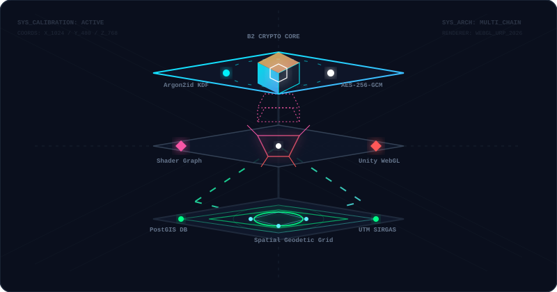

<div align="center">

# Diego Henrique Oris de Roa Antunes (Diego Antunes)
### **Senior Full Stack Software Engineer • Systems Architect • Fractional CTO**
#### *Especialista em Web3 (DEX/CEX), Criptografia, Compiladores, Computação Espacial, Games (Unity), Apps Mobile & Sistemas de Baixa Latência*

<p align="center">
  <a href="https://diegooris.ch/"></a>
  <a href="https://wa.me/5511974289097"></a>
  <a href="https://www.linkedin.com/in/diegoorisderoa/"></a>
  <a href="https://www.youtube.com/@GraphTechChannel"></a>
  <a href="https://diegoorisderoa.medium.com/"></a>
</p>

<p align="center">
  
  
  
  
  
</p>

<p align="center">
  
</p>

</div>

---

## 🧭 Painel de Filtros Rápidos (Navegação Interativa Direta)

Filtre e explore o portfólio selecionado de projetos de alta complexidade diretamente através dos links rápidos e acordeões colapsáveis:

<div align="center">

| 📂 **Filtrar por Categoria** | 💻 **Filtrar por Linguagem** | 🛠️ **Filtrar por Stack / Camada** |
|:---|:---|:---|
| • [⛓️ Web3, DeFi & CEX](#cat-web3)<br>• [🛡️ Criptografia & Segurança](#cat-crypto)<br>• [🗺️ GIS, Cartografia & Games 3D](#cat-gis)<br>• [⚙️ Baixo Nível & Emulação](#cat-lowlevel)<br>• [🤖 IA, Visão & Automação](#cat-ai)<br>• [📱 Mobile (iOS & Android)](#cat-mobile)<br>• [🏢 Enterprise & LegalTech](#cat-enterprise) | • [🦀 Rust](#lang-rust)<br>• [📜 Scala](#lang-scala)<br>• [⚡ TypeScript / JavaScript](#lang-ts-js)<br>• [💎 Solidity & Ride](#lang-solidity-ride)<br>• [🐍 Python](#lang-python)<br>• [🎮 C / C++ & C# (Unity Game Engine)](#lang-c-cpp)<br>• [🍎 Swift](#lang-swift)<br>• [🎯 Dart / Flutter](#lang-flutter)<br>• [☕ Java & Kotlin](#lang-java)<br>• [🐘 Go, Shell & PHP](#lang-php) | • [🖥️ Frontend & Web3 UI](#stack-frontend)<br>• [🔌 Backend & Microserviços](#stack-backend)<br>• [🔗 Smart Contracts & Core](#stack-contracts)<br>• [📲 Mobile & Apps iOS/Android](#stack-mobile)<br>• [🌐 Bancos, GIS & Games 3D](#stack-gis)<br>• [🔒 Segurança & Hardening](#stack-security) |

</div>

> 🚀 **Visão Consolidada:** Acesse os [📌 4 Projetos Pinned / Destaques](#pinned) ou a [📊 Matriz Geral com Todos os Projetos Selecionados](#tabela-mestra).

---

<a id="pinned"></a>
## 📌 Projetos em Destaque (Pinned Repositories)

Os quatro pilares técnicos de engenharia em destaque no ecossistema:

<div align="center">

<p align="center">
  <a href="https://github.com/D-H-O-R-A/amzx"></a>
  <a href="https://github.com/D-H-O-R-A/NOrange"></a>
</p>
<p align="center">
  <a href="https://github.com/D-H-O-R-A/b2-wallet"></a>
  <a href="https://github.com/D-H-O-R-A/consensus"></a>
</p>

| Projeto | Domínio & Engenharia | Stack Tecnológica | Destaque Arquitetural |
|:---|:---|:---|:---|
| **[AMZX](https://github.com/D-H-O-R-A/amzx)** | Blockchain L1 Core & Consenso | Scala, Akka, LevelDB, Scorex, LPoS | Nó de blockchain distribuída L1 customizada baseada em Waves, contratos inteligentes Ride e transações de alta vazão. |
| **[NOrange](https://github.com/D-H-O-R-A/NOrange)** | Cibersegurança & Rede Móvel | Java, Android SDK, OpenVPN, Tun2Socks | Suíte tática de privacidade e rede para Android: cliente OpenVPN, proxy HTTP/SOCKS5 local e gateway hotspot sem root. |
| **[b2-wallet](https://github.com/D-H-O-R-A/b2-wallet)** | Web3 & Carteiras Auto-Custódia | React, Vite, WebCrypto, Argon2id, Ledger | Carteira multi-chain de nível institucional (39+ redes), hardware wallet WebUSB e derivação de chaves anti-brute force GPU. |
| **[consensus](https://github.com/D-H-O-R-A/consensus)** | Algoritmos de Consenso Distribuído | Swift, Concurrency, State Machines | Modelagem algorítmica e comparativa em Swift dos principais consensos (PoW, PoS, DPoS, PoH, LPoS). |

</div>

---

## 👨‍💻 Sobre Mim & Bagagem Profissional

Engenheiro de Software Sênior, Arquiteto de Sistemas e Empreendedor Técnico com **mais de 8 anos de experiência contínua em produção** e **mais de 100 projetos desenvolvidos**. Atuação global cobrindo clientes corporativos, startups de hiper-crescimento e governos em mais de 10 países: **Suíça, Estados Unidos, Alemanha, França, China, Brasil, Argentina, Rússia e Ucrânia**.

Especializado em assumir desafios de **extrema complexidade algorítmica e arquitetural**, transformando conceitos greenfield em **MVPs robustos de nível de produção em 3 a 8 semanas** — aplicando princípios de *Zero-Rewrite Architecture* (Domain-Driven Design, contratos tipados rigorosos e isolamento modular de domínio) para que a aplicação suporte escala corporativa desde o primeiro bloco de código.

### 🏛️ Validações Executivas & Prova Social de Alto Impacto
*   **Brunet (Inventor Suíço & Empreendedor de Alta Tecnologia):**  
    *Contexto:* Mais de 4 milhões de dólares/francos suíços haviam sido investidos ao longo de 6 anos com equipes do Vale do Silício e agências internacionais sem atingir a solução técnica viável para um deadlock algorítmico crítico.  
    *Resultado:* Diego assumiu o projeto de forma autônoma e desenvolveu a resolução completa de arquitetura e engenharia em 1 ano.  
    *Verificação Pública:* [Instagram Oficial do Brunet](https://www.instagram.com/brunet_inventor/).
*   **Cássio Alvarenga (Investidor & Executivo do Mercado Financeiro, Dubai / Emirados Árabes Unidos):**  
    *Contexto:* Atuação como Fractional CTO da Amazonic One em sprint intensivo para desenhar a custódia descentralizada e a tokenização de créditos de carbono (eRWA).  
    *Resultado:* Entrega rigorosa da infraestrutura blockchain, explorador de ledger e suíte de carteiras institucionais no prazo.  
    *Verificação Pública:* [LinkedIn de Cássio Alvarenga](https://www.linkedin.com/in/cassioalvarenga/).
*   **Acelerações & Reconhecimento Institucional:**  
    Projetos e startups fundadas/lideradas tecnicamente foram selecionados e acelerados por programas como **InovAtiva Brasil (Sebrae)**, **Instituto Caldeira** e Editais de Inovação Tecnológica.

---

## 📂 1. Catálogo Completo por Categoria de Projeto

*(Projetos confidenciais sob contrato corporativo/NDA estão identificados com `🔒` e constam apenas com nome e síntese técnica, sem links externos).*

<a id="cat-web3"></a>
### ⛓️ Categoria 1: Web3, Blockchain Core, DeFi, DEX & CEX

*Infraestrutura de livros-razão distribuídos, nós L1, oráculos, formadores automáticos de mercado (DEX), corretoras centralizadas de alta frequência (CEX estilo Binance), staking e custódia institucional.*

| Projeto | Acesso / Status | Linguagem | Stack Principal | Destaque Técnico |
|:---|:---:|:---:|:---|:---|
| **[AnyStakeProtocol](https://github.com/D-H-O-R-A/AnyStakeProtocol)** | [🌐 Repositório](https://github.com/D-H-O-R-A/AnyStakeProtocol) | Solidity | Solidity, Hardhat, Multi-Token Staking, EVM | Protocolo descentralizado de staking flexível com suporte a múltiplos ativos ERC-20 e yield distribuído. |
| **[Waves](https://github.com/D-H-O-R-A/Waves)** | [🌐 Repositório](https://github.com/D-H-O-R-A/Waves) | Scala | Scala, Akka Actors, LevelDB, Scorex Framework, LPoS | Nó oficial de referência da blockchain Waves: protocolo de consenso, verificação de blocos e máquina de estados. |
| **[address-generator](https://github.com/D-H-O-R-A/address-generator)** | [🌐 Repositório](https://github.com/D-H-O-R-A/address-generator) | JavaScript | Node.js, BIP-39, BIP-44, Secp256k1, Multi-chain Derivation | Gerador determinístico de endereços públicos e chaves criptográficas para múltiplas blockchains. |
| **[amzexplorer](https://github.com/D-H-O-R-A/amzexplorer)** | [🌐 Repositório](https://github.com/D-H-O-R-A/amzexplorer) | TypeScript | Next.js, TypeScript, Tailwind CSS, Blockchain Ledger APIs | Explorador oficial de blocos e registros imutáveis de ativos ambientais (eRWA) da Amazonic One. |
| **[amzx](https://github.com/D-H-O-R-A/amzx)** | [🌐 Repositório](https://github.com/D-H-O-R-A/amzx) | Scala | Scala, Akka, LevelDB, Waves Core Platform, LPoS | Implementação e nó L1 de blockchain customizada com suporte a contratos inteligentes Ride e alta taxa de TPS. |
| **[b2-wallet](https://github.com/D-H-O-R-A/b2-wallet)** | [🌐 Repositório](https://github.com/D-H-O-R-A/b2-wallet) | JavaScript | React, Vite, WebCrypto AES-256-GCM, Argon2id KDF, Ledger SDK | B2 Wallet: Carteira institucional de auto-custódia multi-chain (39+ redes), hardware wallet WebUSB e criptografia avançada. |
| **[bot-alias-waves](https://github.com/D-H-O-R-A/bot-alias-waves)** | [🌐 Repositório](https://github.com/D-H-O-R-A/bot-alias-waves) | JavaScript | Node.js, Waves API, Mass Transactions, Asynchronous Queue | Bot de alta vazão para registro e submissão em lote de transações de apelidos (alias) no protocolo Waves. |
| **[consensus](https://github.com/D-H-O-R-A/consensus)** | [🌐 Repositório](https://github.com/D-H-O-R-A/consensus) | Swift | Swift, Distributed Systems, PoW, PoS, DPoS, PoH, LPoS | Implementação e benchmark comparativo dos principais algoritmos de consenso distribuído em Swift puro. |
| **[gic-sports-website](https://github.com/D-H-O-R-A/gic-sports-website)** | [🌐 Repositório](https://github.com/D-H-O-R-A/gic-sports-website) | TypeScript | TypeScript, React, Next.js, Web3 Connectors | Portal web para emissão e gestão de ativos digitais de atletas e entidades desportivas. |
| **[gicwalletpro](https://github.com/D-H-O-R-A/gicwalletpro)** | [🌐 Repositório](https://github.com/D-H-O-R-A/gicwalletpro) | TypeScript | TypeScript, Chrome Extension Manifest V3, Web3 Injection | GIC Wallet Pro: Extensão de navegador para interação com a rede corporativa GIC Blockchain. |
| **[guaranteed-swap](https://github.com/D-H-O-R-A/guaranteed-swap)** | [🌐 Repositório](https://github.com/D-H-O-R-A/guaranteed-swap) | JavaScript | Web3.js, Atomic Swaps, Liquidity Balancing, Ethers.js | Mecanismo de swap atômico garantido sem intermediários para trocas descentralizadas entre pares. |
| **[matcher](https://github.com/D-H-O-R-A/matcher)** | [🌐 Repositório](https://github.com/D-H-O-R-A/matcher) | Scala | Scala, Akka Streams, High-Frequency Matching Engine | Engine descentralizado de correspondência e liquidação de ordens financeiras em nós Waves. |
| **[matcher_amzx](https://github.com/D-H-O-R-A/matcher_amzx)** | [🌐 Repositório](https://github.com/D-H-O-R-A/matcher_amzx) | Scala | Scala, LevelDB, High-Throughput DEX Matcher, AMZX | Mecanismo de cruzamento de ofertas de alta performance para a DEX oficial da rede AMZX. |
| **[paychain](https://github.com/D-H-O-R-A/paychain)** | [🌐 Repositório](https://github.com/D-H-O-R-A/paychain) | Go / Rust | Go, Distributed Ledger, Instant Finality, Private Transactions | Blockchain orientada a pagamentos corporativos de alta velocidade com privacidade de dados e microtaxas. |
| **[planetone-explorer](https://github.com/D-H-O-R-A/planetone-explorer)** | [🌐 Repositório](https://github.com/D-H-O-R-A/planetone-explorer) | TypeScript | React, TypeScript, Tailwind CSS, WebSockets, Carbon Data | Explorador em tempo real da blockchain Planet One para monitoramento de ativos ambientais (eRWA) e nós validadores. |
| **[proxy-gic-metamask](https://github.com/D-H-O-R-A/proxy-gic-metamask)** | [🌐 Repositório](https://github.com/D-H-O-R-A/proxy-gic-metamask) | JavaScript | Node.js, gRPC, GoWaves, JSON-RPC Shim, MetaMask / Trust Wallet | Camada de compatibilidade (RPC proxy) que permite conectar MetaMask e Trust Wallet a blockchains GoWaves. |
| **[solana-stake](https://github.com/D-H-O-R-A/solana-stake)** | [🌐 Repositório](https://github.com/D-H-O-R-A/solana-stake) | JavaScript | Solana Web3.js, Anchor, SPL Tokens, Staking Rewards | Aplicação de staking descentralizado nativa da rede Solana para rendimento e bloqueio de tokens SPL. |
| **[solidity-defi](https://github.com/D-H-O-R-A/solidity-defi)** | [🌐 Repositório](https://github.com/D-H-O-R-A/solidity-defi) | Solidity | Solidity, Hardhat, Foundry, OpenZeppelin, DeFi Primitives | Suíte completa de contratos inteligentes em Solidity para operações de finanças descentralizadas (Staking, Vaults, Swaps). |
| **[swopfi-smart-contracts](https://github.com/D-H-O-R-A/swopfi-smart-contracts)** | [🌐 Repositório](https://github.com/D-H-O-R-A/swopfi-smart-contracts) | Ride | Ride, AMM (Automated Market Maker), Liquidity Pools, Waves | Contratos inteligentes em Ride para formadores de mercado automatizados (AMM) e swaps descentralizados. |
| **[ym-explorer](https://github.com/D-H-O-R-A/ym-explorer)** | [🌐 Repositório](https://github.com/D-H-O-R-A/ym-explorer) | TypeScript | TypeScript, React, Next.js, Blockchain Ledger Explorer | Explorador de blocos e transações de ativos desportivos tokenizados da rede Young Market. |
| **[ymcore](https://github.com/D-H-O-R-A/ymcore)** | [🌐 Repositório](https://github.com/D-H-O-R-A/ymcore) | Go | Go (Golang), gRPC, LevelDB, Young Market Core Daemon | Implementação em Go do daemon de nó e bibliotecas de baixo nível para a rede Young Market. |
| **Bicon DEX** | 🔒 Sob Contrato / Confidencial (NDA) | Solidity / TypeScript | Solidity, Hardhat, AMM Engine, Slippage Routing, React Web3 | Exchange descentralizada (DEX) de formador de mercado automatizado (AMM) com roteamento de liquidez e 30% de economia em gas. |
| **Zero Swap** | 🔒 Sob Contrato / Confidencial (NDA) | Solidity | Hardhat, Foundry, Layer 2 Rollups, Private Flash Swaps, MEV Shield | DEX multi-chain com roteamento de slippage zero e proteção nativa de pools contra ataques de frontrunning e MEV. |
| **Waves DEX** | 🔒 Sob Contrato / Confidencial (NDA) | Scala / Ride | Waves Protocol, Matcher Engine, Ride Smart Contracts, LevelDB OrderBook | Exchange descentralizada de alta vazão no ecossistema Waves com execução de ordens via livro de ofertas em memória. |
| **Solarex Finance** | 🔒 Sob Contrato / Confidencial (NDA) | Solidity | Solidity, Hardhat, Tokenomics, EVM, Staking & Yield Vaults | Protocolo e DEX de finanças descentralizadas com emissão programável, queima, pools de liquidez e vaults de rendimento. |
| **Duck Swap** | 🔒 Sob Contrato / Confidencial (NDA) | Solidity / Ride | AMM Algorithm, Constant Product Formula (x*y=k), Multi-Asset Pools | Protocolo descentralizado de troca instantânea de tokens e provisão de liquidez com incentivo dinâmico de taxas. |
| **Giddy Marketplace** | 🔒 Sob Contrato / Confidencial (NDA) | Solidity / TypeScript | Solidity, ERC-721/1155, EIP-2981 Royalties, On-Chain Escrow, Next.js | Marketplace e hub descentralizado de negociação de ativos digitais com leilões em tempo real e liquidação on-chain. |
| **viper-king-swap** | 🔒 Sob Contrato / Confidencial (NDA) | TypeScript | TypeScript, Web3, DEX Router, Multi-hop Routing, Liquidity Aggregation | Roteador descentralizado de ordens multi-hop e agregador de liquidez para execução de swaps com mínimo slippage. |
| **Futfinance** | 🔒 Sob Contrato / Confidencial (NDA) | Go / Node.js | Go, Node.js, High-Frequency Matching Engine, Redis In-Memory OrderBook, WebSockets | Corretora centralizada (CEX estilo Binance) de alta performance: livro de ofertas em memória, matching de ordens ultra-rápido e gateway fiat. |
| **3Bee Exchange** | 🔒 Sob Contrato / Confidencial (NDA) | Go / PostgreSQL | Go, PostgreSQL, Redis, Multi-currency Ledger, Hot/Cold Wallet Treasury, REST/WS APIs | Plataforma de exchange centralizada institucional (CEX) com custódia segregada, motor de correspondência e auditoria de saldos em tempo real. |
| **IO Binários** | 🔒 Sob Contrato / Confidencial (NDA) | TypeScript / C++ | Node.js, C++ Addons, High-Frequency WebSockets, Real-time Candlestick Feed, Risk Engine | Plataforma de alta frequência para negociação de opções binárias e derivativos com streaming de cotações em sub-milissegundos. |
| **micron-stake** | 🔒 Sob Contrato / Confidencial (NDA) | Solidity / JavaScript | Solidity, Web3.js, Bitci Network, Dynamic APR Staking Engine | Plataforma e smart contracts de staking descentralizado multi-chain com cálculo dinâmico de APR e liquidação programada. |
| **waves-payment** | 🔒 Sob Contrato / Confidencial (NDA) | PHP | PHP, WordPress, WooCommerce API, Waves Payment Gateway | Plugin WooCommerce para integração e liquidação de pagamentos em criptoativos da rede Waves em lojas virtuais. |
| **GIC Wallet Pro Enterprise** | 🔒 Sob Contrato / Confidencial (NDA) | Solidity / TS | Multi-sig Treasury, Institutional Governance, WebCrypto API | Tesouraria corporativa com assinatura múltipla e governança criptográfica para fundos institucionais. |
| **Amazonic Pay** | 🔒 Sob Contrato / Confidencial (NDA) | TypeScript | Next.js, Node.js, Web3 On-ramp, Cross-border Settlement Gateway | Gateway de liquidação cross-border reduzindo taxas de remessa de 4.5% para <0.5%. |
| **Young Market Core** | 🔒 Sob Contrato (Venture / NDA) | Ride / Node.js | Waves Enterprise Core, Ride Contracts, CVM Compliance, Stripe | Plataforma de tokenização de direitos creditórios de atletas e crowdfunding sob regulação da CVM. |
| **Planet One Wallet** | 🔒 Sob Contrato / Confidencial (NDA) | TypeScript | React, Tailwind, EVM & Custom L1 Integration, eRWA Custody | Carteira institucional para emissão e transferência de ativos do mundo real e créditos de carbono. |
| **Meta-X-Wallet** | 🔒 Sob Contrato / Confidencial (NDA) | TypeScript | React 18, TypeScript, Web3 Providers, Multi-asset Custody | Custódia descentralizada e gestão multi-ativo de carteiras digitais corporativas. |
| **AMZ Wallet** | 🔒 Sob Contrato / Confidencial (NDA) | TypeScript | TypeScript, Waves/AMZX Connectors, Carbon Credit Transfers | Carteira dedicada para transacionar ativos de compensação ambiental e certificados verdes. |
| **Sistema de Auditoria de Consenso** | 🔒 Sob Contrato / Confidencial (NDA) | Swift / Go | Distributed Benchmarking, Fault Tolerance, Byzantine Simulation | Suíte para análise e benchmarking de tolerância a falhas bizantinas em redes descentralizadas. |

<a id="cat-crypto"></a>
### 🛡️ Categoria 2: Criptografia, Segurança, Cibersegurança & RE

*Segurança defensiva, engenharia reversa de firmware bare-metal, derivação determinística de chaves e túneis de privacidade.*

| Projeto | Acesso / Status | Linguagem | Stack Principal | Destaque Técnico |
|:---|:---:|:---:|:---|:---|
| **[CryptoSeedRecovery](https://github.com/D-H-O-R-A/CryptoSeedRecovery)** | [🌐 Repositório](https://github.com/D-H-O-R-A/CryptoSeedRecovery) | JavaScript | BIP-39, BIP-44, Electrum, Levenshtein, Tree Pruning, SLSA 3 | Engine CLI e lib de alta performance para restauração de sementes mnemônicas perdidas em 39 blockchains simultâneas. |
| **[aoc-le32s5760-mt5880-firmware-research](https://github.com/D-H-O-R-A/aoc-le32s5760-mt5880-firmware-research)** | [🌐 Repositório](https://github.com/D-H-O-R-A/aoc-le32s5760-mt5880-firmware-research) | Python / C | MediaTek MT5880, DLM Reversing, dm-bht, MSTAR, Cryptographic Chain-of-Trust | Engenharia reversa forense em Smart TV: análise de cadeias de confiança criptográfica, containers DLM e partições mtd12. |
| **[bulletproofs](https://github.com/D-H-O-R-A/bulletproofs)** | [🌐 Repositório](https://github.com/D-H-O-R-A/bulletproofs) | Pesquisa / ZK | Zero-Knowledge Proofs, Bulletproofs, Elliptic Curve Cryptography | Pesquisa aprofundada e implementação didático-técnica de provas de intervalo de conhecimento zero sem trusted setup. |
| **Hide-Protocol-App-VPN** | 🔒 Sob Contrato / Confidencial (NDA) | Dart / C | Flutter, OpenVPN, Shadowsocks/V2Ray, Stealth Tunnels, WireGuard | Suíte móvel de privacidade com camuflagem de pacotes contra DPI (Deep Packet Inspection). |
| **Laboratório Forense OmeTV** | 🔒 Sob Contrato / Confidencial (NDA) | JavaScript | Node.js, WebRTC Forensics, Secure WebSockets (WSS), Packet Sniffing | Ambiente especializado para auditoria de segurança, descriptografia de handshake e análise forense WebRTC. |
| **Engine de Derivação Criptográfica** | 🔒 Sob Contrato / Confidencial (NDA) | Rust / WebCrypto | Rust, Argon2id, AES-256-GCM, Constant-Time Primitives | Módulo proprietário de derivação e hashing de chaves criptográficas em tempo constante resistente a ataques de canal lateral. |

<a id="cat-gis"></a>
### 🗺️ Categoria 3: Computação Espacial, GIS & Games 3D (Unity / WebGL)

*Engines de jogos em Unity (C#), compiladores cartográficos, conversão geodésica elipsoidal em tempo real, física 3D e realidade aumentada.*

| Projeto | Acesso / Status | Linguagem | Stack Principal | Destaque Técnico |
|:---|:---:|:---:|:---|:---|
| **[Scanning-and-Detecting-3D-Objects](https://github.com/D-H-O-R-A/Scanning-and-Detecting-3D-Objects)** | [🌐 Repositório](https://github.com/D-H-O-R-A/Scanning-and-Detecting-3D-Objects) | Swift | Swift, ARKit, SceneKit, 3D Spatial Point Cloud Mapping | Captura e persistência de nuvens de pontos 3D de objetos físicos para rastreamento espacial e Realidade Aumentada. |
| **[pdf-to-maps](https://github.com/D-H-O-R-A/pdf-to-maps)** | [🌐 Repositório](https://github.com/D-H-O-R-A/pdf-to-maps) | TypeScript | Three.js, WebGL, SIRGAS2000 UTM, DXF, GeoJSON, SLSA Level 3 | Compilador cartográfico 100% offline: transforma PDFs do INCRA/SIGEF em modelos 3D WebGL, DXF e GeoJSON em sub-segundos. |
| **Parque Estadual São João Marcos — The Game** | 🔒 Sob Contrato (NDA) | C# / Unity | Unity 3D, C#, Universal Render Pipeline (URP), WebGL Build, Historical Rebuild | Jogo de exploração interativa 3D e reconstrução histórica do sítio arqueológico desenvolvido em Unity com alta fidelidade gráfica. |
| **SeteAlem - The game** | 🔒 Sob Contrato (NDA) | C# / Unity | Unity 3D, C#, Custom HLSL Shaders, Atmospheric Lighting, Narrative FSM | Jogo 3D imersivo de atmosfera e suspense desenvolvido em Unity com renderização customizada e máquinas de estados. |
| **Sinuca Club** | 🔒 Sob Contrato (NDA) | C# / Unity | Unity 3D, C#, Rigidbody Physics Math, Real-time Multiplayer, Ball Collision | Simulador de bilhar/sinuca 3D com física matemática de precisão e partidas multijogador em tempo real na Unity. |
| **Cidade de Deus - The game** | 🔒 Sob Contrato (NDA) | C# / Unity | Unity 3D, C#, Open World Asset Streaming, AI NavMeshes, Ragdoll Physics | Jogo 3D de ação e simulação urbana em mundo aberto na Unity com streaming contínuo de cenários e IA de NPCs. |
| **Match Blocks MVP** | 🔒 Sob Contrato (NDA) | C# / Unity | Unity 2022 LTS, C#, URP, HLSL Shaders, PostGIS R-Tree, Deterministic RNG | Engine híbrida de jogo e processamento de malhas espaciais processando 10.000 registros territoriais por minuto. |
| **cubedetector** | 🔒 Sob Contrato / Confidencial (NDA) | Swift | Swift, ARKit, Vision Framework, 3D Spatial Geometry | Reconhecimento e rastreamento em tempo real de geometrias cúbicas no espaço tridimensional com ARKit. |
| **lens_detector** | 🔒 Sob Contrato / Confidencial (NDA) | JavaScript | JavaScript, HTML5 Canvas, Optical Distortion Algorithms | Algoritmo de visão computacional em navegador para calibração de distorção óptica e análise de lentes de câmeras. |

<a id="cat-lowlevel"></a>
### ⚙️ Categoria 4: Sistemas de Baixo Nível, Emulação & Compiladores

*Desenvolvimento próximo ao hardware, tradução binária, otimização de ciclos de CPU e emulação de sistemas operacionais.*

| Projeto | Acesso / Status | Linguagem | Stack Principal | Destaque Técnico |
|:---|:---:|:---:|:---|:---|
| **[Android-real-emulator](https://github.com/D-H-O-R-A/Android-real-emulator)** | [🌐 Repositório](https://github.com/D-H-O-R-A/Android-real-emulator) | Rust | Rust, Android SDK/NDK, ARM64 Translation (libndk), Magisk | DroidRun: Runner open-source em Rust para rodar o Android Oficial em desktops com Google Play e tradução ARM64. |
| **[BlackServerOS](https://github.com/D-H-O-R-A/BlackServerOS)** | [🌐 Repositório](https://github.com/D-H-O-R-A/BlackServerOS) | Shell | Bash, Linux Kernel Hardening, Minimal Security Appliance | Scripts e automação para compilação de appliance Linux minimalista de alta segurança para servidores de missão crítica. |
| **[ar-ml-iOS-measure-detect](https://github.com/D-H-O-R-A/ar-ml-iOS-measure-detect)** | [🌐 Repositório](https://github.com/D-H-O-R-A/ar-ml-iOS-measure-detect) | C++ | C++, OpenCV, Metal Shaders, Low-Level SIMD, iOS | Pipeline em C++ de baixa latência para visão computacional, medições métricas e inferência em iOS. |

<a id="cat-ai"></a>
### 🤖 Categoria 5: Inteligência Artificial, Visão Computacional & Automação

*Pipelines RAG (Retrieval-Augmented Generation), bots autônomos, visão computacional e agentes conversacionais.*

| Projeto | Acesso / Status | Linguagem | Stack Principal | Destaque Técnico |
|:---|:---:|:---:|:---|:---|
| **[AICryptoPrediction](https://github.com/D-H-O-R-A/AICryptoPrediction)** | [🌐 Repositório](https://github.com/D-H-O-R-A/AICryptoPrediction) | Python | Python, PyTorch, LSTM/Transformers, Time-Series Forecasting | Engine de inteligência artificial para previsão de preços de criptoativos baseada em séries temporais. |
| **[RealChar](https://github.com/D-H-O-R-A/RealChar)** | [🌐 Repositório](https://github.com/D-H-O-R-A/RealChar) | Python / TS | Python, WebSockets, ElevenLabs, OpenAI Whisper, Conversational AI | Engine conversacional em tempo real para criação e diálogo com avatares autônomos de inteligência artificial. |
| **[SharpOSAI](https://github.com/D-H-O-R-A/SharpOSAI)** | [🌐 Repositório](https://github.com/D-H-O-R-A/SharpOSAI) | Python | Python, FastAPI, Neural Pipeline Orchestration, Task Workers | Infraestrutura em Python para orquestração de chamadas neurais e fluxos de automação cognitiva. |
| **[arXivisual](https://github.com/D-H-O-R-A/arXivisual)** | [🌐 Repositório](https://github.com/D-H-O-R-A/arXivisual) | TypeScript | TypeScript, React, LLM Visual Summarization, TartanHacks Winner | Plataforma de sumarização visual de artigos científicos através de agentes de inteligência artificial (Premiado no TartanHacks). |
| **[codebuff](https://github.com/D-H-O-R-A/codebuff)** | [🌐 Repositório](https://github.com/D-H-O-R-A/codebuff) | TypeScript | TypeScript, Node.js, CLI Agent, LLM Code Generation | Agente CLI de terminal para geração e refatoração autônoma de código em tempo real via modelos LLM. |
| **[youtube-automation-agent](https://github.com/D-H-O-R-A/youtube-automation-agent)** | [🌐 Repositório](https://github.com/D-H-O-R-A/youtube-automation-agent) | Python | Python, YouTube Data API v3, LLM Agent, Content Pipelines | Agente autônomo de inteligência artificial para automação completa de upload, otimização de SEO e gestão de canais. |
| **METATRON** | 🔒 Sob Contrato (NDA Governamental) | TypeScript | Next.js, Node.js, Biometria Facial / IA, PostGIS, Alertas Táticos | Sistema Integrado de Inteligência & Captura de Foragidos para Segurança Pública, cruzando alertas em tempo real. |
| **ChatBuilder (Satochat)** | 🔒 Sob Contrato / Confidencial (NDA) | TypeScript | Next.js, LangChain, Embeddings, Vector Database, Cloud Functions | Plataforma SaaS para treinamento e implantação de agentes de conversação autônomos baseados em sites. |

<a id="cat-mobile"></a>
### 📱 Categoria 6: Mobile Nativa & Cross-Platform (iOS & Android)

*Aplicativos móveis de alta concorrência em Flutter e Android Nativo: marketplaces georreferenciados, delivery sob demanda, imobiliárias, portais de clube e privacidade.*

| Projeto | Acesso / Status | Linguagem | Stack Principal | Destaque Técnico |
|:---|:---:|:---:|:---|:---|
| **[NOrange](https://github.com/D-H-O-R-A/NOrange)** | [🌐 Repositório](https://github.com/D-H-O-R-A/NOrange) | Java | Android SDK, OpenVPN Core, Tun2Socks, HTTP/SOCKS5 Proxy, Hotspot | Suíte tática de privacidade e rede para Android: cliente OpenVPN, servidor proxy local e gateway hotspot sem root. |
| **Click Serviços** | 🔒 Sob Contrato / Confidencial (NDA) | Dart / Flutter | Flutter (BloC), NestJS, PostgreSQL/PostGIS (R-Tree Index), Redis BullMQ, FCM | Aplicativo mobile marketplace (iOS & Android) de alta concorrência para matching em tempo real de serviços por proximidade geográfica. |
| **Inseo Web** | 🔒 Sob Contrato / Confidencial (NDA) | TypeScript / Flutter | Flutter Mobile, Next.js, Cloud Analytics, Push Notifications, SEO Engine | Ecossistema mobile e web para auditoria técnica, monitoramento de performance de aplicações e indexação inteligente. |
| **Emaximóvel Imobiliária** | 🔒 Sob Contrato / Confidencial (NDA) | Dart / Flutter | Flutter (iOS & Android), Firebase, Google Maps SDK, CRM Imobiliário Integrado | Aplicativo mobile completo para o setor imobiliário: busca geolocalizada de imóveis, agendamento de visitas e chat integrado com corretores. |
| **Pizza Delivery** | 🔒 Sob Contrato / Confidencial (NDA) | Dart / Flutter | Flutter (iOS & Android), Node.js, WebSockets, Live GPS Tracking, Pix/Cartão | Aplicativo móvel sob demanda de delivery gastronômico com rastreamento GPS de entregadores em tempo real e despacho automático. |
| **Petshop Delivery** | 🔒 Sob Contrato / Confidencial (NDA) | Dart / Flutter | Flutter (iOS & Android), Firebase Cloud Firestore, Catalogo E-commerce, Push Notifications | Plataforma mobile para comércio eletrônico pet e agendamento de serviços veterinários/estéticos com entrega rápida. |
| **Compass Club** | 🔒 Sob Contrato / Confidencial (NDA) | Dart / Flutter | Flutter (iOS & Android), QR Code Access Control, Membership Rewards, Stripe | Aplicativo mobile exclusivo para membros de clube privado: credencial digital via QR dinâmico, reservas de eventos e programa de fidelidade. |
| **Golfe Clube** | 🔒 Sob Contrato / Confidencial (NDA) | Dart / Flutter | Flutter (iOS & Android), Tee-Time Scheduling Algorithm, Handicap Scoring, GPS Yardage | Aplicativo esportivo mobile para gestão de campos de golfe, agendamento de partidas (tee times), scorecards digitais e torneios. |
| **AuraTV** | 🔒 Sob Contrato / Confidencial (NDA) | TypeScript / Dart | WebRTC Mesh, Firebase, Concorrência Maciça, Gamificação | Plataforma social móvel de streaming de vídeo P2P e competições ao vivo em tempo real. |

<a id="cat-enterprise"></a>
### 🏢 Categoria 7: Plataformas Corporativas, LegalTech, GovTech & SaaS

*Plataformas multi-tenant, billing internacional, integrações regulatórias, inteligência jurídica e infraestrutura corporativa.*

| Projeto | Acesso / Status | Linguagem | Stack Principal | Destaque Técnico |
|:---|:---:|:---:|:---|:---|
| **[Fluxx](https://github.com/D-H-O-R-A/Fluxx)** | [🌐 Repositório](https://github.com/D-H-O-R-A/Fluxx) | Dart / Flutter | Flutter, Dart, SQLite, Responsive UI | Aplicativo mobile para controle e inteligência financeira pessoal com gráficos interativos e relatórios offline. |
| **[Subway-money](https://github.com/D-H-O-R-A/Subway-money)** | [🌐 Repositório](https://github.com/D-H-O-R-A/Subway-money) | PHP | PHP 8, MySQL, Payment Gateway Integration, Pix Webhooks | Backend financeiro para processamento instantâneo de depósitos e saques em jogos transacionais. |
| **AgroGestor** | 🔒 Sob Contrato / Confidencial (NDA) | TypeScript / Dart | Next.js, Firebase DataConnect, Flutter Mobile, Cloud Functions | Plataforma corporativa multi-tenant para gestão rural: safras, rebanhos zootécnicos, patrimônio e maquinário. |
| **Solucione Multas** | 🔒 Sob Contrato (Co-fundador & CTO) | TypeScript | React, Cloud Firestore, WhatsApp Cloud API, Conversational AI | LegalTech com portal do cliente, backoffice jurídico e triagem autônoma de leads via WhatsApp Oficial. |
| **Anjo Online** | 🔒 Sob Contrato / Confidencial (NDA) | TypeScript | NestJS, Next.js, PostgreSQL, Docker, Cloud Run, TWINT, Mercado Pago | SaaS internacional de arrecadação filantrópica com gateway duplo de liquidação bancária (Suíça / Brasil). |
| **Planet One Official Portal** | 🔒 Sob Contrato / Confidencial (NDA) | TypeScript | Nuxt 3, Nitro, Tailwind CSS, Web3 Connectors | Portal institucional corporativo da infraestrutura blockchain Planet One para ativos ambientais. |
| **Better2Better Website & Core** | 🔒 Sob Contrato / Confidencial (NDA) | TypeScript | Next.js, Tailwind CSS, Internationalization, B2 Ecosystem | Hub institucional e ecossistema de produtos da Better2Better. |
| **DDM Website** | 🔒 Sob Contrato / Confidencial (NDA) | TypeScript | React, TypeScript, Cloudflare Edge, Modern Design System | Infraestrutura web corporativa institucional de alta disponibilidade. |

---

## 💻 2. Filtro Interativo por Linguagens de Programação

Expanda os painéis abaixo para inspecionar os projetos por stack de linguagem:

<details>
<summary><a id="lang-rust"></a><h3>🦀 Rust (2 Projetos) — Clique para Expandir</h3></summary>

| Projeto | Status / Acesso | Categoria | Descrição Técnica |
|:---|:---:|:---|:---|
| **[Android-real-emulator](https://github.com/D-H-O-R-A/Android-real-emulator)** | [🌐 GitHub](https://github.com/D-H-O-R-A/Android-real-emulator) | Baixo Nível & Emulação | DroidRun: Runner open-source em Rust para rodar o Android Oficial em desktops com Google Play e tradução ARM64. |
| **Engine de Derivação Criptográfica** | 🔒 Sob Contrato / Confidencial (NDA) | Criptografia, Segurança & RE | Módulo proprietário de derivação e hashing de chaves criptográficas em tempo constante resistente a ataques de canal lateral. |

</details>

<details>
<summary><a id="lang-scala"></a><h3>📜 Scala (5 Projetos) — Clique para Expandir</h3></summary>

| Projeto | Status / Acesso | Categoria | Descrição Técnica |
|:---|:---:|:---|:---|
| **[Waves](https://github.com/D-H-O-R-A/Waves)** | [🌐 GitHub](https://github.com/D-H-O-R-A/Waves) | Web3, L1/L2 & DeFi | Nó oficial de referência da blockchain Waves: protocolo de consenso, verificação de blocos e máquina de estados. |
| **[amzx](https://github.com/D-H-O-R-A/amzx)** | [🌐 GitHub](https://github.com/D-H-O-R-A/amzx) | Web3, L1/L2 & DeFi | Implementação e nó L1 de blockchain customizada com suporte a contratos inteligentes Ride e alta taxa de TPS. |
| **[matcher](https://github.com/D-H-O-R-A/matcher)** | [🌐 GitHub](https://github.com/D-H-O-R-A/matcher) | Web3, L1/L2 & DeFi | Engine descentralizado de correspondência e liquidação de ordens financeiras em nós Waves. |
| **[matcher_amzx](https://github.com/D-H-O-R-A/matcher_amzx)** | [🌐 GitHub](https://github.com/D-H-O-R-A/matcher_amzx) | Web3, L1/L2 & DeFi | Mecanismo de cruzamento de ofertas de alta performance para a DEX oficial da rede AMZX. |
| **Waves DEX** | 🔒 Sob Contrato / Confidencial (NDA) | Web3, L1/L2 & DeFi | Exchange descentralizada de alta vazão no ecossistema Waves com execução de ordens via livro de ofertas em memória. |

</details>

<details>
<summary><a id="lang-ts-js"></a><h3>⚡ TypeScript & JavaScript (30 Projetos) — Clique para Expandir</h3></summary>

| Projeto | Status / Acesso | Categoria | Descrição Técnica |
|:---|:---:|:---|:---|
| **[CryptoSeedRecovery](https://github.com/D-H-O-R-A/CryptoSeedRecovery)** | [🌐 GitHub](https://github.com/D-H-O-R-A/CryptoSeedRecovery) | Criptografia, Segurança & RE | Engine CLI e lib de alta performance para restauração de sementes mnemônicas perdidas em 39 blockchains simultâneas. |
| **[address-generator](https://github.com/D-H-O-R-A/address-generator)** | [🌐 GitHub](https://github.com/D-H-O-R-A/address-generator) | Web3, L1/L2 & DeFi | Gerador determinístico de endereços públicos e chaves criptográficas para múltiplas blockchains. |
| **[amzexplorer](https://github.com/D-H-O-R-A/amzexplorer)** | [🌐 GitHub](https://github.com/D-H-O-R-A/amzexplorer) | Web3, L1/L2 & DeFi | Explorador oficial de blocos e registros imutáveis de ativos ambientais (eRWA) da Amazonic One. |
| **[arXivisual](https://github.com/D-H-O-R-A/arXivisual)** | [🌐 GitHub](https://github.com/D-H-O-R-A/arXivisual) | IA, Visão & Automação | Plataforma de sumarização visual de artigos científicos através de agentes de inteligência artificial (Premiado no TartanHacks). |
| **[b2-wallet](https://github.com/D-H-O-R-A/b2-wallet)** | [🌐 GitHub](https://github.com/D-H-O-R-A/b2-wallet) | Web3, L1/L2 & DeFi | B2 Wallet: Carteira institucional de auto-custódia multi-chain (39+ redes), hardware wallet WebUSB e criptografia avançada. |
| **[bot-alias-waves](https://github.com/D-H-O-R-A/bot-alias-waves)** | [🌐 GitHub](https://github.com/D-H-O-R-A/bot-alias-waves) | Web3, L1/L2 & DeFi | Bot de alta vazão para registro e submissão em lote de transações de apelidos (alias) no protocolo Waves. |
| **[codebuff](https://github.com/D-H-O-R-A/codebuff)** | [🌐 GitHub](https://github.com/D-H-O-R-A/codebuff) | IA, Visão & Automação | Agente CLI de terminal para geração e refatoração autônoma de código em tempo real via modelos LLM. |
| **[gic-sports-website](https://github.com/D-H-O-R-A/gic-sports-website)** | [🌐 GitHub](https://github.com/D-H-O-R-A/gic-sports-website) | Web3, L1/L2 & DeFi | Portal web para emissão e gestão de ativos digitais de atletas e entidades desportivas. |
| **[gicwalletpro](https://github.com/D-H-O-R-A/gicwalletpro)** | [🌐 GitHub](https://github.com/D-H-O-R-A/gicwalletpro) | Web3, L1/L2 & DeFi | GIC Wallet Pro: Extensão de navegador para interação com a rede corporativa GIC Blockchain. |
| **[guaranteed-swap](https://github.com/D-H-O-R-A/guaranteed-swap)** | [🌐 GitHub](https://github.com/D-H-O-R-A/guaranteed-swap) | Web3, L1/L2 & DeFi | Mecanismo de swap atômico garantido sem intermediários para trocas descentralizadas entre pares. |
| **[pdf-to-maps](https://github.com/D-H-O-R-A/pdf-to-maps)** | [🌐 GitHub](https://github.com/D-H-O-R-A/pdf-to-maps) | Computação Espacial, GIS & 3D | Compilador cartográfico 100% offline: transforma PDFs do INCRA/SIGEF em modelos 3D WebGL, DXF e GeoJSON em sub-segundos. |
| **[planetone-explorer](https://github.com/D-H-O-R-A/planetone-explorer)** | [🌐 GitHub](https://github.com/D-H-O-R-A/planetone-explorer) | Web3, L1/L2 & DeFi | Explorador em tempo real da blockchain Planet One para monitoramento de ativos ambientais (eRWA) e nós validadores. |
| **[proxy-gic-metamask](https://github.com/D-H-O-R-A/proxy-gic-metamask)** | [🌐 GitHub](https://github.com/D-H-O-R-A/proxy-gic-metamask) | Web3, L1/L2 & DeFi | Camada de compatibilidade (RPC proxy) que permite conectar MetaMask e Trust Wallet a blockchains GoWaves. |
| **[solana-stake](https://github.com/D-H-O-R-A/solana-stake)** | [🌐 GitHub](https://github.com/D-H-O-R-A/solana-stake) | Web3, L1/L2 & DeFi | Aplicação de staking descentralizado nativa da rede Solana para rendimento e bloqueio de tokens SPL. |
| **[ym-explorer](https://github.com/D-H-O-R-A/ym-explorer)** | [🌐 GitHub](https://github.com/D-H-O-R-A/ym-explorer) | Web3, L1/L2 & DeFi | Explorador de blocos e transações de ativos desportivos tokenizados da rede Young Market. |
| **viper-king-swap** | 🔒 Sob Contrato / Confidencial (NDA) | Web3, L1/L2 & DeFi | Roteador descentralizado de ordens multi-hop e agregador de liquidez para execução de swaps com mínimo slippage. |
| **IO Binários** | 🔒 Sob Contrato / Confidencial (NDA) | Web3, L1/L2 & DeFi | Plataforma de alta frequência para negociação de opções binárias e derivativos com streaming de cotações em sub-milissegundos. |
| **Amazonic Pay** | 🔒 Sob Contrato / Confidencial (NDA) | Web3, L1/L2 & DeFi | Gateway de liquidação cross-border reduzindo taxas de remessa de 4.5% para <0.5%. |
| **Planet One Wallet** | 🔒 Sob Contrato / Confidencial (NDA) | Web3, L1/L2 & DeFi | Carteira institucional para emissão e transferência de ativos do mundo real e créditos de carbono. |
| **Meta-X-Wallet** | 🔒 Sob Contrato / Confidencial (NDA) | Web3, L1/L2 & DeFi | Custódia descentralizada e gestão multi-ativo de carteiras digitais corporativas. |
| **AMZ Wallet** | 🔒 Sob Contrato / Confidencial (NDA) | Web3, L1/L2 & DeFi | Carteira dedicada para transacionar ativos de compensação ambiental e certificados verdes. |
| **lens_detector** | 🔒 Sob Contrato / Confidencial (NDA) | Computação Espacial, GIS & 3D | Algoritmo de visão computacional em navegador para calibração de distorção óptica e análise de lentes de câmeras. |
| **METATRON** | 🔒 Sob Contrato (NDA Governamental) | IA, Visão & Automação | Sistema Integrado de Inteligência & Captura de Foragidos para Segurança Pública, cruzando alertas em tempo real. |
| **ChatBuilder (Satochat)** | 🔒 Sob Contrato / Confidencial (NDA) | IA, Visão & Automação | Plataforma SaaS para treinamento e implantação de agentes de conversação autônomos baseados em sites. |
| **Laboratório Forense OmeTV** | 🔒 Sob Contrato / Confidencial (NDA) | Criptografia, Segurança & RE | Ambiente especializado para auditoria de segurança, descriptografia de handshake e análise forense WebRTC. |
| **Solucione Multas** | 🔒 Sob Contrato (Co-fundador & CTO) | Enterprise & Web Corporativa | LegalTech com portal do cliente, backoffice jurídico e triagem autônoma de leads via WhatsApp Oficial. |
| **Anjo Online** | 🔒 Sob Contrato / Confidencial (NDA) | Enterprise & Web Corporativa | SaaS internacional de arrecadação filantrópica com gateway duplo de liquidação bancária (Suíça / Brasil). |
| **Planet One Official Portal** | 🔒 Sob Contrato / Confidencial (NDA) | Enterprise & Web Corporativa | Portal institucional corporativo da infraestrutura blockchain Planet One para ativos ambientais. |
| **Better2Better Website & Core** | 🔒 Sob Contrato / Confidencial (NDA) | Enterprise & Web Corporativa | Hub institucional e ecossistema de produtos da Better2Better. |
| **DDM Website** | 🔒 Sob Contrato / Confidencial (NDA) | Enterprise & Web Corporativa | Infraestrutura web corporativa institucional de alta disponibilidade. |

</details>

<details>
<summary><a id="lang-solidity-ride"></a><h3>💎 Solidity & Ride (12 Projetos) — Clique para Expandir</h3></summary>

| Projeto | Status / Acesso | Categoria | Descrição Técnica |
|:---|:---:|:---|:---|
| **[AnyStakeProtocol](https://github.com/D-H-O-R-A/AnyStakeProtocol)** | [🌐 GitHub](https://github.com/D-H-O-R-A/AnyStakeProtocol) | Web3, L1/L2 & DeFi | Protocolo descentralizado de staking flexível com suporte a múltiplos ativos ERC-20 e yield distribuído. |
| **[solidity-defi](https://github.com/D-H-O-R-A/solidity-defi)** | [🌐 GitHub](https://github.com/D-H-O-R-A/solidity-defi) | Web3, L1/L2 & DeFi | Suíte completa de contratos inteligentes em Solidity para operações de finanças descentralizadas (Staking, Vaults, Swaps). |
| **[swopfi-smart-contracts](https://github.com/D-H-O-R-A/swopfi-smart-contracts)** | [🌐 GitHub](https://github.com/D-H-O-R-A/swopfi-smart-contracts) | Web3, L1/L2 & DeFi | Contratos inteligentes em Ride para formadores de mercado automatizados (AMM) e swaps descentralizados. |
| **Bicon DEX** | 🔒 Sob Contrato / Confidencial (NDA) | Web3, L1/L2 & DeFi | Exchange descentralizada (DEX) de formador de mercado automatizado (AMM) com roteamento de liquidez e 30% de economia em gas. |
| **Zero Swap** | 🔒 Sob Contrato / Confidencial (NDA) | Web3, L1/L2 & DeFi | DEX multi-chain com roteamento de slippage zero e proteção nativa de pools contra ataques de frontrunning e MEV. |
| **Solarex Finance** | 🔒 Sob Contrato / Confidencial (NDA) | Web3, L1/L2 & DeFi | Protocolo e DEX de finanças descentralizadas com emissão programável, queima, pools de liquidez e vaults de rendimento. |
| **Duck Swap** | 🔒 Sob Contrato / Confidencial (NDA) | Web3, L1/L2 & DeFi | Protocolo descentralizado de troca instantânea de tokens e provisão de liquidez com incentivo dinâmico de taxas. |
| **Giddy Marketplace** | 🔒 Sob Contrato / Confidencial (NDA) | Web3, L1/L2 & DeFi | Marketplace e hub descentralizado de negociação de ativos digitais com leilões em tempo real e liquidação on-chain. |
| **micron-stake** | 🔒 Sob Contrato / Confidencial (NDA) | Web3, L1/L2 & DeFi | Plataforma e smart contracts de staking descentralizado multi-chain com cálculo dinâmico de APR e liquidação programada. |
| **GIC Wallet Pro Enterprise** | 🔒 Sob Contrato / Confidencial (NDA) | Web3, L1/L2 & DeFi | Tesouraria corporativa com assinatura múltipla e governança criptográfica para fundos institucionais. |
| **Young Market Core** | 🔒 Sob Contrato (Venture / NDA) | Web3, L1/L2 & DeFi | Plataforma de tokenização de direitos creditórios de atletas e crowdfunding sob regulação da CVM. |

</details>

<details>
<summary><a id="lang-python"></a><h3>🐍 Python (5 Projetos) — Clique para Expandir</h3></summary>

| Projeto | Status / Acesso | Categoria | Descrição Técnica |
|:---|:---:|:---|:---|
| **[AICryptoPrediction](https://github.com/D-H-O-R-A/AICryptoPrediction)** | [🌐 GitHub](https://github.com/D-H-O-R-A/AICryptoPrediction) | IA, Visão & Automação | Engine de inteligência artificial para previsão de preços de criptoativos baseada em séries temporais. |
| **[RealChar](https://github.com/D-H-O-R-A/RealChar)** | [🌐 GitHub](https://github.com/D-H-O-R-A/RealChar) | IA, Visão & Automação | Engine conversacional em tempo real para criação e diálogo com avatares autônomos de inteligência artificial. |
| **[SharpOSAI](https://github.com/D-H-O-R-A/SharpOSAI)** | [🌐 GitHub](https://github.com/D-H-O-R-A/SharpOSAI) | IA, Visão & Automação | Infraestrutura em Python para orquestração de chamadas neurais e fluxos de automação cognitiva. |
| **[aoc-le32s5760-mt5880-firmware-research](https://github.com/D-H-O-R-A/aoc-le32s5760-mt5880-firmware-research)** | [🌐 GitHub](https://github.com/D-H-O-R-A/aoc-le32s5760-mt5880-firmware-research) | Criptografia, Segurança & RE | Engenharia reversa forense em Smart TV: análise de cadeias de confiança criptográfica, containers DLM e partições mtd12. |
| **[youtube-automation-agent](https://github.com/D-H-O-R-A/youtube-automation-agent)** | [🌐 GitHub](https://github.com/D-H-O-R-A/youtube-automation-agent) | IA, Visão & Automação | Agente autônomo de inteligência artificial para automação completa de upload, otimização de SEO e gestão de canais. |

</details>

<details>
<summary><a id="lang-c-cpp"></a><h3>🎮 C / C++ & C# (Unity Game Engine) (11 Projetos) — Clique para Expandir</h3></summary>

| Projeto | Status / Acesso | Categoria | Descrição Técnica |
|:---|:---:|:---|:---|
| **[ar-ml-iOS-measure-detect](https://github.com/D-H-O-R-A/ar-ml-iOS-measure-detect)** | [🌐 GitHub](https://github.com/D-H-O-R-A/ar-ml-iOS-measure-detect) | Baixo Nível & Emulação | Pipeline em C++ de baixa latência para visão computacional, medições métricas e inferência em iOS. |
| **[bulletproofs](https://github.com/D-H-O-R-A/bulletproofs)** | [🌐 GitHub](https://github.com/D-H-O-R-A/bulletproofs) | Criptografia, Segurança & RE | Pesquisa aprofundada e implementação didático-técnica de provas de intervalo de conhecimento zero sem trusted setup. |
| **[paychain](https://github.com/D-H-O-R-A/paychain)** | [🌐 GitHub](https://github.com/D-H-O-R-A/paychain) | Web3, L1/L2 & DeFi | Blockchain orientada a pagamentos corporativos de alta velocidade com privacidade de dados e microtaxas. |
| **[ymcore](https://github.com/D-H-O-R-A/ymcore)** | [🌐 GitHub](https://github.com/D-H-O-R-A/ymcore) | Web3, L1/L2 & DeFi | Implementação em Go do daemon de nó e bibliotecas de baixo nível para a rede Young Market. |
| **Futfinance** | 🔒 Sob Contrato / Confidencial (NDA) | Web3, L1/L2 & DeFi | Corretora centralizada (CEX estilo Binance) de alta performance: livro de ofertas em memória, matching de ordens ultra-rápido e gateway fiat. |
| **3Bee Exchange** | 🔒 Sob Contrato / Confidencial (NDA) | Web3, L1/L2 & DeFi | Plataforma de exchange centralizada institucional (CEX) com custódia segregada, motor de correspondência e auditoria de saldos em tempo real. |
| **Parque Estadual São João Marcos — The Game** | 🔒 Sob Contrato (NDA) | Computação Espacial, GIS & 3D | Jogo de exploração interativa 3D e reconstrução histórica do sítio arqueológico desenvolvido em Unity com alta fidelidade gráfica. |
| **SeteAlem - The game** | 🔒 Sob Contrato (NDA) | Computação Espacial, GIS & 3D | Jogo 3D imersivo de atmosfera e suspense desenvolvido em Unity com renderização customizada e máquinas de estados. |
| **Sinuca Club** | 🔒 Sob Contrato (NDA) | Computação Espacial, GIS & 3D | Simulador de bilhar/sinuca 3D com física matemática de precisão e partidas multijogador em tempo real na Unity. |
| **Cidade de Deus - The game** | 🔒 Sob Contrato (NDA) | Computação Espacial, GIS & 3D | Jogo 3D de ação e simulação urbana em mundo aberto na Unity com streaming contínuo de cenários e IA de NPCs. |
| **Match Blocks MVP** | 🔒 Sob Contrato (NDA) | Computação Espacial, GIS & 3D | Engine híbrida de jogo e processamento de malhas espaciais processando 10.000 registros territoriais por minuto. |

</details>

<details>
<summary><a id="lang-swift"></a><h3>🍎 Swift (4 Projetos) — Clique para Expandir</h3></summary>

| Projeto | Status / Acesso | Categoria | Descrição Técnica |
|:---|:---:|:---|:---|
| **[Scanning-and-Detecting-3D-Objects](https://github.com/D-H-O-R-A/Scanning-and-Detecting-3D-Objects)** | [🌐 GitHub](https://github.com/D-H-O-R-A/Scanning-and-Detecting-3D-Objects) | Computação Espacial, GIS & 3D | Captura e persistência de nuvens de pontos 3D de objetos físicos para rastreamento espacial e Realidade Aumentada. |
| **[consensus](https://github.com/D-H-O-R-A/consensus)** | [🌐 GitHub](https://github.com/D-H-O-R-A/consensus) | Web3, L1/L2 & DeFi | Implementação e benchmark comparativo dos principais algoritmos de consenso distribuído em Swift puro. |
| **Sistema de Auditoria de Consenso** | 🔒 Sob Contrato / Confidencial (NDA) | Web3, L1/L2 & DeFi | Suíte para análise e benchmarking de tolerância a falhas bizantinas em redes descentralizadas. |
| **cubedetector** | 🔒 Sob Contrato / Confidencial (NDA) | Computação Espacial, GIS & 3D | Reconhecimento e rastreamento em tempo real de geometrias cúbicas no espaço tridimensional com ARKit. |

</details>

<details>
<summary><a id="lang-flutter"></a><h3>🎯 Dart / Flutter (iOS & Android) (11 Projetos) — Clique para Expandir</h3></summary>

| Projeto | Status / Acesso | Categoria | Descrição Técnica |
|:---|:---:|:---|:---|
| **[Fluxx](https://github.com/D-H-O-R-A/Fluxx)** | [🌐 GitHub](https://github.com/D-H-O-R-A/Fluxx) | Enterprise & Web Corporativa | Aplicativo mobile para controle e inteligência financeira pessoal com gráficos interativos e relatórios offline. |
| **Click Serviços** | 🔒 Sob Contrato / Confidencial (NDA) | Mobile & Telecom VPN | Aplicativo mobile marketplace (iOS & Android) de alta concorrência para matching em tempo real de serviços por proximidade geográfica. |
| **Inseo Web** | 🔒 Sob Contrato / Confidencial (NDA) | Mobile & Telecom VPN | Ecossistema mobile e web para auditoria técnica, monitoramento de performance de aplicações e indexação inteligente. |
| **Emaximóvel Imobiliária** | 🔒 Sob Contrato / Confidencial (NDA) | Mobile & Telecom VPN | Aplicativo mobile completo para o setor imobiliário: busca geolocalizada de imóveis, agendamento de visitas e chat integrado com corretores. |
| **Pizza Delivery** | 🔒 Sob Contrato / Confidencial (NDA) | Mobile & Telecom VPN | Aplicativo móvel sob demanda de delivery gastronômico com rastreamento GPS de entregadores em tempo real e despacho automático. |
| **Petshop Delivery** | 🔒 Sob Contrato / Confidencial (NDA) | Mobile & Telecom VPN | Plataforma mobile para comércio eletrônico pet e agendamento de serviços veterinários/estéticos com entrega rápida. |
| **Compass Club** | 🔒 Sob Contrato / Confidencial (NDA) | Mobile & Telecom VPN | Aplicativo mobile exclusivo para membros de clube privado: credencial digital via QR dinâmico, reservas de eventos e programa de fidelidade. |
| **Golfe Clube** | 🔒 Sob Contrato / Confidencial (NDA) | Mobile & Telecom VPN | Aplicativo esportivo mobile para gestão de campos de golfe, agendamento de partidas (tee times), scorecards digitais e torneios. |
| **AuraTV** | 🔒 Sob Contrato / Confidencial (NDA) | Mobile & Telecom VPN | Plataforma social móvel de streaming de vídeo P2P e competições ao vivo em tempo real. |
| **Hide-Protocol-App-VPN** | 🔒 Sob Contrato / Confidencial (NDA) | Criptografia, Segurança & RE | Suíte móvel de privacidade com camuflagem de pacotes contra DPI (Deep Packet Inspection). |
| **AgroGestor** | 🔒 Sob Contrato / Confidencial (NDA) | Enterprise & Web Corporativa | Plataforma corporativa multi-tenant para gestão rural: safras, rebanhos zootécnicos, patrimônio e maquinário. |

</details>

<details>
<summary><a id="lang-java"></a><h3>☕ Java & Kotlin (1 Projetos) — Clique para Expandir</h3></summary>

| Projeto | Status / Acesso | Categoria | Descrição Técnica |
|:---|:---:|:---|:---|
| **[NOrange](https://github.com/D-H-O-R-A/NOrange)** | [🌐 GitHub](https://github.com/D-H-O-R-A/NOrange) | Mobile & Telecom VPN | Suíte tática de privacidade e rede para Android: cliente OpenVPN, servidor proxy local e gateway hotspot sem root. |

</details>

<details>
<summary><a id="lang-php"></a><h3>🐘 Go, Shell & PHP (3 Projetos) — Clique para Expandir</h3></summary>

| Projeto | Status / Acesso | Categoria | Descrição Técnica |
|:---|:---:|:---|:---|
| **[BlackServerOS](https://github.com/D-H-O-R-A/BlackServerOS)** | [🌐 GitHub](https://github.com/D-H-O-R-A/BlackServerOS) | Baixo Nível & Emulação | Scripts e automação para compilação de appliance Linux minimalista de alta segurança para servidores de missão crítica. |
| **[Subway-money](https://github.com/D-H-O-R-A/Subway-money)** | [🌐 GitHub](https://github.com/D-H-O-R-A/Subway-money) | Enterprise & Web Corporativa | Backend financeiro para processamento instantâneo de depósitos e saques em jogos transacionais. |
| **waves-payment** | 🔒 Sob Contrato / Confidencial (NDA) | Web3, L1/L2 & DeFi | Plugin WooCommerce para integração e liquidação de pagamentos em criptoativos da rede Waves em lojas virtuais. |

</details>

---

## 🛠️ 3. Filtro Interativo por Stack & Camada de Arquitetura

<details>
<summary><a id="stack-frontend"></a><h3>🖥️ Frontend & Interfaces Web3 (15 Projetos) — Clique para Expandir</h3></summary>

*Aplicações de ponta em React 18/19, Next.js, Vite, Three.js, WebGL e Tailwind CSS.*

| Projeto | Linguagem | Status / Acesso | Destaque Arquitetural |
|:---|:---:|:---:|:---|
| **[amzexplorer](https://github.com/D-H-O-R-A/amzexplorer)** | TypeScript | [🌐 Código](https://github.com/D-H-O-R-A/amzexplorer) | Explorador oficial de blocos e registros imutáveis de ativos ambientais (eRWA) da Amazonic One. |
| **[arXivisual](https://github.com/D-H-O-R-A/arXivisual)** | TypeScript | [🌐 Código](https://github.com/D-H-O-R-A/arXivisual) | Plataforma de sumarização visual de artigos científicos através de agentes de inteligência artificial (Premiado no TartanHacks). |
| **[b2-wallet](https://github.com/D-H-O-R-A/b2-wallet)** | JavaScript | [🌐 Código](https://github.com/D-H-O-R-A/b2-wallet) | B2 Wallet: Carteira institucional de auto-custódia multi-chain (39+ redes), hardware wallet WebUSB e criptografia avançada. |
| **[gic-sports-website](https://github.com/D-H-O-R-A/gic-sports-website)** | TypeScript | [🌐 Código](https://github.com/D-H-O-R-A/gic-sports-website) | Portal web para emissão e gestão de ativos digitais de atletas e entidades desportivas. |
| **[gicwalletpro](https://github.com/D-H-O-R-A/gicwalletpro)** | TypeScript | [🌐 Código](https://github.com/D-H-O-R-A/gicwalletpro) | GIC Wallet Pro: Extensão de navegador para interação com a rede corporativa GIC Blockchain. |
| **[planetone-explorer](https://github.com/D-H-O-R-A/planetone-explorer)** | TypeScript | [🌐 Código](https://github.com/D-H-O-R-A/planetone-explorer) | Explorador em tempo real da blockchain Planet One para monitoramento de ativos ambientais (eRWA) e nós validadores. |
| **[ym-explorer](https://github.com/D-H-O-R-A/ym-explorer)** | TypeScript | [🌐 Código](https://github.com/D-H-O-R-A/ym-explorer) | Explorador de blocos e transações de ativos desportivos tokenizados da rede Young Market. |
| **Planet One Wallet** | TypeScript | 🔒 Sob Contrato / Confidencial (NDA) | Carteira institucional para emissão e transferência de ativos do mundo real e créditos de carbono. |
| **Meta-X-Wallet** | TypeScript | 🔒 Sob Contrato / Confidencial (NDA) | Custódia descentralizada e gestão multi-ativo de carteiras digitais corporativas. |
| **AMZ Wallet** | TypeScript | 🔒 Sob Contrato / Confidencial (NDA) | Carteira dedicada para transacionar ativos de compensação ambiental e certificados verdes. |
| **AgroGestor** | TypeScript / Dart | 🔒 Sob Contrato / Confidencial (NDA) | Plataforma corporativa multi-tenant para gestão rural: safras, rebanhos zootécnicos, patrimônio e maquinário. |
| **Solucione Multas** | TypeScript | 🔒 Sob Contrato (Co-fundador & CTO) | LegalTech com portal do cliente, backoffice jurídico e triagem autônoma de leads via WhatsApp Oficial. |
| **Planet One Official Portal** | TypeScript | 🔒 Sob Contrato / Confidencial (NDA) | Portal institucional corporativo da infraestrutura blockchain Planet One para ativos ambientais. |
| **Better2Better Website & Core** | TypeScript | 🔒 Sob Contrato / Confidencial (NDA) | Hub institucional e ecossistema de produtos da Better2Better. |
| **DDM Website** | TypeScript | 🔒 Sob Contrato / Confidencial (NDA) | Infraestrutura web corporativa institucional de alta disponibilidade. |

</details>

<details>
<summary><a id="stack-backend"></a><h3>🔌 Backend, Microserviços & Matching Engines (17 Projetos) — Clique para Expandir</h3></summary>

*Serviços escaláveis em Go, Node.js, NestJS, FastAPI, Redis In-Memory OrderBook, BullMQ e gRPC.*

| Projeto | Linguagem | Status / Acesso | Destaque Arquitetural |
|:---|:---:|:---:|:---|
| **[AICryptoPrediction](https://github.com/D-H-O-R-A/AICryptoPrediction)** | Python | [🌐 Código](https://github.com/D-H-O-R-A/AICryptoPrediction) | Engine de inteligência artificial para previsão de preços de criptoativos baseada em séries temporais. |
| **[RealChar](https://github.com/D-H-O-R-A/RealChar)** | Python / TS | [🌐 Código](https://github.com/D-H-O-R-A/RealChar) | Engine conversacional em tempo real para criação e diálogo com avatares autônomos de inteligência artificial. |
| **[SharpOSAI](https://github.com/D-H-O-R-A/SharpOSAI)** | Python | [🌐 Código](https://github.com/D-H-O-R-A/SharpOSAI) | Infraestrutura em Python para orquestração de chamadas neurais e fluxos de automação cognitiva. |
| **[Subway-money](https://github.com/D-H-O-R-A/Subway-money)** | PHP | [🌐 Código](https://github.com/D-H-O-R-A/Subway-money) | Backend financeiro para processamento instantâneo de depósitos e saques em jogos transacionais. |
| **[bot-alias-waves](https://github.com/D-H-O-R-A/bot-alias-waves)** | JavaScript | [🌐 Código](https://github.com/D-H-O-R-A/bot-alias-waves) | Bot de alta vazão para registro e submissão em lote de transações de apelidos (alias) no protocolo Waves. |
| **[codebuff](https://github.com/D-H-O-R-A/codebuff)** | TypeScript | [🌐 Código](https://github.com/D-H-O-R-A/codebuff) | Agente CLI de terminal para geração e refatoração autônoma de código em tempo real via modelos LLM. |
| **[matcher](https://github.com/D-H-O-R-A/matcher)** | Scala | [🌐 Código](https://github.com/D-H-O-R-A/matcher) | Engine descentralizado de correspondência e liquidação de ordens financeiras em nós Waves. |
| **[proxy-gic-metamask](https://github.com/D-H-O-R-A/proxy-gic-metamask)** | JavaScript | [🌐 Código](https://github.com/D-H-O-R-A/proxy-gic-metamask) | Camada de compatibilidade (RPC proxy) que permite conectar MetaMask e Trust Wallet a blockchains GoWaves. |
| **[youtube-automation-agent](https://github.com/D-H-O-R-A/youtube-automation-agent)** | Python | [🌐 Código](https://github.com/D-H-O-R-A/youtube-automation-agent) | Agente autônomo de inteligência artificial para automação completa de upload, otimização de SEO e gestão de canais. |
| **Futfinance** | Go / Node.js | 🔒 Sob Contrato / Confidencial (NDA) | Corretora centralizada (CEX estilo Binance) de alta performance: livro de ofertas em memória, matching de ordens ultra-rápido e gateway fiat. |
| **3Bee Exchange** | Go / PostgreSQL | 🔒 Sob Contrato / Confidencial (NDA) | Plataforma de exchange centralizada institucional (CEX) com custódia segregada, motor de correspondência e auditoria de saldos em tempo real. |
| **IO Binários** | TypeScript / C++ | 🔒 Sob Contrato / Confidencial (NDA) | Plataforma de alta frequência para negociação de opções binárias e derivativos com streaming de cotações em sub-milissegundos. |
| **waves-payment** | PHP | 🔒 Sob Contrato / Confidencial (NDA) | Plugin WooCommerce para integração e liquidação de pagamentos em criptoativos da rede Waves em lojas virtuais. |
| **Amazonic Pay** | TypeScript | 🔒 Sob Contrato / Confidencial (NDA) | Gateway de liquidação cross-border reduzindo taxas de remessa de 4.5% para <0.5%. |
| **METATRON** | TypeScript | 🔒 Sob Contrato (NDA Governamental) | Sistema Integrado de Inteligência & Captura de Foragidos para Segurança Pública, cruzando alertas em tempo real. |
| **ChatBuilder (Satochat)** | TypeScript | 🔒 Sob Contrato / Confidencial (NDA) | Plataforma SaaS para treinamento e implantação de agentes de conversação autônomos baseados em sites. |
| **Anjo Online** | TypeScript | 🔒 Sob Contrato / Confidencial (NDA) | SaaS internacional de arrecadação filantrópica com gateway duplo de liquidação bancária (Suíça / Brasil). |

</details>

<details>
<summary><a id="stack-contracts"></a><h3>🔗 Smart Contracts & Blockchain Core (DEX/L1) (24 Projetos) — Clique para Expandir</h3></summary>

*Protocolos em Solidity, Ride, EVM, Hardhat, Foundry, Akka e Waves Core.*

| Projeto | Linguagem | Status / Acesso | Destaque Arquitetural |
|:---|:---:|:---:|:---|
| **[AnyStakeProtocol](https://github.com/D-H-O-R-A/AnyStakeProtocol)** | Solidity | [🌐 Código](https://github.com/D-H-O-R-A/AnyStakeProtocol) | Protocolo descentralizado de staking flexível com suporte a múltiplos ativos ERC-20 e yield distribuído. |
| **[Waves](https://github.com/D-H-O-R-A/Waves)** | Scala | [🌐 Código](https://github.com/D-H-O-R-A/Waves) | Nó oficial de referência da blockchain Waves: protocolo de consenso, verificação de blocos e máquina de estados. |
| **[address-generator](https://github.com/D-H-O-R-A/address-generator)** | JavaScript | [🌐 Código](https://github.com/D-H-O-R-A/address-generator) | Gerador determinístico de endereços públicos e chaves criptográficas para múltiplas blockchains. |
| **[amzx](https://github.com/D-H-O-R-A/amzx)** | Scala | [🌐 Código](https://github.com/D-H-O-R-A/amzx) | Implementação e nó L1 de blockchain customizada com suporte a contratos inteligentes Ride e alta taxa de TPS. |
| **[consensus](https://github.com/D-H-O-R-A/consensus)** | Swift | [🌐 Código](https://github.com/D-H-O-R-A/consensus) | Implementação e benchmark comparativo dos principais algoritmos de consenso distribuído em Swift puro. |
| **[guaranteed-swap](https://github.com/D-H-O-R-A/guaranteed-swap)** | JavaScript | [🌐 Código](https://github.com/D-H-O-R-A/guaranteed-swap) | Mecanismo de swap atômico garantido sem intermediários para trocas descentralizadas entre pares. |
| **[matcher_amzx](https://github.com/D-H-O-R-A/matcher_amzx)** | Scala | [🌐 Código](https://github.com/D-H-O-R-A/matcher_amzx) | Mecanismo de cruzamento de ofertas de alta performance para a DEX oficial da rede AMZX. |
| **[paychain](https://github.com/D-H-O-R-A/paychain)** | Go / Rust | [🌐 Código](https://github.com/D-H-O-R-A/paychain) | Blockchain orientada a pagamentos corporativos de alta velocidade com privacidade de dados e microtaxas. |
| **[solana-stake](https://github.com/D-H-O-R-A/solana-stake)** | JavaScript | [🌐 Código](https://github.com/D-H-O-R-A/solana-stake) | Aplicação de staking descentralizado nativa da rede Solana para rendimento e bloqueio de tokens SPL. |
| **[solidity-defi](https://github.com/D-H-O-R-A/solidity-defi)** | Solidity | [🌐 Código](https://github.com/D-H-O-R-A/solidity-defi) | Suíte completa de contratos inteligentes em Solidity para operações de finanças descentralizadas (Staking, Vaults, Swaps). |
| **[swopfi-smart-contracts](https://github.com/D-H-O-R-A/swopfi-smart-contracts)** | Ride | [🌐 Código](https://github.com/D-H-O-R-A/swopfi-smart-contracts) | Contratos inteligentes em Ride para formadores de mercado automatizados (AMM) e swaps descentralizados. |
| **[ymcore](https://github.com/D-H-O-R-A/ymcore)** | Go | [🌐 Código](https://github.com/D-H-O-R-A/ymcore) | Implementação em Go do daemon de nó e bibliotecas de baixo nível para a rede Young Market. |
| **Bicon DEX** | Solidity / TypeScript | 🔒 Sob Contrato / Confidencial (NDA) | Exchange descentralizada (DEX) de formador de mercado automatizado (AMM) com roteamento de liquidez e 30% de economia em gas. |
| **Zero Swap** | Solidity | 🔒 Sob Contrato / Confidencial (NDA) | DEX multi-chain com roteamento de slippage zero e proteção nativa de pools contra ataques de frontrunning e MEV. |
| **Waves DEX** | Scala / Ride | 🔒 Sob Contrato / Confidencial (NDA) | Exchange descentralizada de alta vazão no ecossistema Waves com execução de ordens via livro de ofertas em memória. |
| **Solarex Finance** | Solidity | 🔒 Sob Contrato / Confidencial (NDA) | Protocolo e DEX de finanças descentralizadas com emissão programável, queima, pools de liquidez e vaults de rendimento. |
| **Duck Swap** | Solidity / Ride | 🔒 Sob Contrato / Confidencial (NDA) | Protocolo descentralizado de troca instantânea de tokens e provisão de liquidez com incentivo dinâmico de taxas. |
| **Giddy Marketplace** | Solidity / TypeScript | 🔒 Sob Contrato / Confidencial (NDA) | Marketplace e hub descentralizado de negociação de ativos digitais com leilões em tempo real e liquidação on-chain. |
| **viper-king-swap** | TypeScript | 🔒 Sob Contrato / Confidencial (NDA) | Roteador descentralizado de ordens multi-hop e agregador de liquidez para execução de swaps com mínimo slippage. |
| **micron-stake** | Solidity / JavaScript | 🔒 Sob Contrato / Confidencial (NDA) | Plataforma e smart contracts de staking descentralizado multi-chain com cálculo dinâmico de APR e liquidação programada. |
| **GIC Wallet Pro Enterprise** | Solidity / TS | 🔒 Sob Contrato / Confidencial (NDA) | Tesouraria corporativa com assinatura múltipla e governança criptográfica para fundos institucionais. |
| **Young Market Core** | Ride / Node.js | 🔒 Sob Contrato (Venture / NDA) | Plataforma de tokenização de direitos creditórios de atletas e crowdfunding sob regulação da CVM. |
| **Sistema de Auditoria de Consenso** | Swift / Go | 🔒 Sob Contrato / Confidencial (NDA) | Suíte para análise e benchmarking de tolerância a falhas bizantinas em redes descentralizadas. |

</details>

<details>
<summary><a id="stack-mobile"></a><h3>📲 Mobile & Apps iOS/Android (10 Projetos) — Clique para Expandir</h3></summary>

*Aplicações nativas e cross-platform em Flutter, Dart, Android Nativo (Java), VpnService e WebSockets em tempo real.*

| Projeto | Linguagem | Status / Acesso | Destaque Arquitetural |
|:---|:---:|:---:|:---|
| **[Fluxx](https://github.com/D-H-O-R-A/Fluxx)** | Dart / Flutter | [🌐 Código](https://github.com/D-H-O-R-A/Fluxx) | Aplicativo mobile para controle e inteligência financeira pessoal com gráficos interativos e relatórios offline. |
| **[NOrange](https://github.com/D-H-O-R-A/NOrange)** | Java | [🌐 Código](https://github.com/D-H-O-R-A/NOrange) | Suíte tática de privacidade e rede para Android: cliente OpenVPN, servidor proxy local e gateway hotspot sem root. |
| **Click Serviços** | Dart / Flutter | 🔒 Sob Contrato / Confidencial (NDA) | Aplicativo mobile marketplace (iOS & Android) de alta concorrência para matching em tempo real de serviços por proximidade geográfica. |
| **Inseo Web** | TypeScript / Flutter | 🔒 Sob Contrato / Confidencial (NDA) | Ecossistema mobile e web para auditoria técnica, monitoramento de performance de aplicações e indexação inteligente. |
| **Emaximóvel Imobiliária** | Dart / Flutter | 🔒 Sob Contrato / Confidencial (NDA) | Aplicativo mobile completo para o setor imobiliário: busca geolocalizada de imóveis, agendamento de visitas e chat integrado com corretores. |
| **Pizza Delivery** | Dart / Flutter | 🔒 Sob Contrato / Confidencial (NDA) | Aplicativo móvel sob demanda de delivery gastronômico com rastreamento GPS de entregadores em tempo real e despacho automático. |
| **Petshop Delivery** | Dart / Flutter | 🔒 Sob Contrato / Confidencial (NDA) | Plataforma mobile para comércio eletrônico pet e agendamento de serviços veterinários/estéticos com entrega rápida. |
| **Compass Club** | Dart / Flutter | 🔒 Sob Contrato / Confidencial (NDA) | Aplicativo mobile exclusivo para membros de clube privado: credencial digital via QR dinâmico, reservas de eventos e programa de fidelidade. |
| **Golfe Clube** | Dart / Flutter | 🔒 Sob Contrato / Confidencial (NDA) | Aplicativo esportivo mobile para gestão de campos de golfe, agendamento de partidas (tee times), scorecards digitais e torneios. |
| **AuraTV** | TypeScript / Dart | 🔒 Sob Contrato / Confidencial (NDA) | Plataforma social móvel de streaming de vídeo P2P e competições ao vivo em tempo real. |

</details>

<details>
<summary><a id="stack-gis"></a><h3>🌐 Bancos de Dados, Motores Geoespaciais e Games 3D (9 Projetos) — Clique para Expandir</h3></summary>

*Engines Unity 3D (C#), processamento geodésico SIRGAS2000 UTM, PostGIS R-Tree e DXF/GeoJSON.*

| Projeto | Linguagem | Status / Acesso | Destaque Arquitetural |
|:---|:---:|:---:|:---|
| **[Scanning-and-Detecting-3D-Objects](https://github.com/D-H-O-R-A/Scanning-and-Detecting-3D-Objects)** | Swift | [🌐 Código](https://github.com/D-H-O-R-A/Scanning-and-Detecting-3D-Objects) | Captura e persistência de nuvens de pontos 3D de objetos físicos para rastreamento espacial e Realidade Aumentada. |
| **[pdf-to-maps](https://github.com/D-H-O-R-A/pdf-to-maps)** | TypeScript | [🌐 Código](https://github.com/D-H-O-R-A/pdf-to-maps) | Compilador cartográfico 100% offline: transforma PDFs do INCRA/SIGEF em modelos 3D WebGL, DXF e GeoJSON em sub-segundos. |
| **Parque Estadual São João Marcos — The Game** | C# / Unity | 🔒 Sob Contrato (NDA) | Jogo de exploração interativa 3D e reconstrução histórica do sítio arqueológico desenvolvido em Unity com alta fidelidade gráfica. |
| **SeteAlem - The game** | C# / Unity | 🔒 Sob Contrato (NDA) | Jogo 3D imersivo de atmosfera e suspense desenvolvido em Unity com renderização customizada e máquinas de estados. |
| **Sinuca Club** | C# / Unity | 🔒 Sob Contrato (NDA) | Simulador de bilhar/sinuca 3D com física matemática de precisão e partidas multijogador em tempo real na Unity. |
| **Cidade de Deus - The game** | C# / Unity | 🔒 Sob Contrato (NDA) | Jogo 3D de ação e simulação urbana em mundo aberto na Unity com streaming contínuo de cenários e IA de NPCs. |
| **Match Blocks MVP** | C# / Unity | 🔒 Sob Contrato (NDA) | Engine híbrida de jogo e processamento de malhas espaciais processando 10.000 registros territoriais por minuto. |
| **cubedetector** | Swift | 🔒 Sob Contrato / Confidencial (NDA) | Reconhecimento e rastreamento em tempo real de geometrias cúbicas no espaço tridimensional com ARKit. |
| **lens_detector** | JavaScript | 🔒 Sob Contrato / Confidencial (NDA) | Algoritmo de visão computacional em navegador para calibração de distorção óptica e análise de lentes de câmeras. |

</details>

<details>
<summary><a id="stack-security"></a><h3>🔒 Segurança, Criptografia & Baixo Nível (9 Projetos) — Clique para Expandir</h3></summary>

*WebCrypto API, Argon2id KDF, AES-256-GCM, Rust, engenharia reversa e SLSA 3.*

| Projeto | Linguagem | Status / Acesso | Destaque Arquitetural |
|:---|:---:|:---:|:---|
| **[Android-real-emulator](https://github.com/D-H-O-R-A/Android-real-emulator)** | Rust | [🌐 Código](https://github.com/D-H-O-R-A/Android-real-emulator) | DroidRun: Runner open-source em Rust para rodar o Android Oficial em desktops com Google Play e tradução ARM64. |
| **[BlackServerOS](https://github.com/D-H-O-R-A/BlackServerOS)** | Shell | [🌐 Código](https://github.com/D-H-O-R-A/BlackServerOS) | Scripts e automação para compilação de appliance Linux minimalista de alta segurança para servidores de missão crítica. |
| **[CryptoSeedRecovery](https://github.com/D-H-O-R-A/CryptoSeedRecovery)** | JavaScript | [🌐 Código](https://github.com/D-H-O-R-A/CryptoSeedRecovery) | Engine CLI e lib de alta performance para restauração de sementes mnemônicas perdidas em 39 blockchains simultâneas. |
| **[aoc-le32s5760-mt5880-firmware-research](https://github.com/D-H-O-R-A/aoc-le32s5760-mt5880-firmware-research)** | Python / C | [🌐 Código](https://github.com/D-H-O-R-A/aoc-le32s5760-mt5880-firmware-research) | Engenharia reversa forense em Smart TV: análise de cadeias de confiança criptográfica, containers DLM e partições mtd12. |
| **[ar-ml-iOS-measure-detect](https://github.com/D-H-O-R-A/ar-ml-iOS-measure-detect)** | C++ | [🌐 Código](https://github.com/D-H-O-R-A/ar-ml-iOS-measure-detect) | Pipeline em C++ de baixa latência para visão computacional, medições métricas e inferência em iOS. |
| **[bulletproofs](https://github.com/D-H-O-R-A/bulletproofs)** | Pesquisa / ZK | [🌐 Código](https://github.com/D-H-O-R-A/bulletproofs) | Pesquisa aprofundada e implementação didático-técnica de provas de intervalo de conhecimento zero sem trusted setup. |
| **Hide-Protocol-App-VPN** | Dart / C | 🔒 Sob Contrato / Confidencial (NDA) | Suíte móvel de privacidade com camuflagem de pacotes contra DPI (Deep Packet Inspection). |
| **Laboratório Forense OmeTV** | JavaScript | 🔒 Sob Contrato / Confidencial (NDA) | Ambiente especializado para auditoria de segurança, descriptografia de handshake e análise forense WebRTC. |
| **Engine de Derivação Criptográfica** | Rust / WebCrypto | 🔒 Sob Contrato / Confidencial (NDA) | Módulo proprietário de derivação e hashing de chaves criptográficas em tempo constante resistente a ataques de canal lateral. |

</details>

---

<a id="tabela-mestra"></a>
## 📊 Matriz Geral de Todos os Projetos (84 Sistemas Selecionados)

A matriz a seguir consolida **os 84 principais projetos de alta complexidade** desenvolvidos, mantidos e liderados tecnicamente por Diego Antunes. Repositórios de código aberto possuem links diretos de acesso; projetos confidenciais sob contrato corporativo/NDA estão protegidos por sigilo contratual conforme as normas vigentes:

| # | Projeto | Categoria Principal | Linguagem | Stack Tecnológica | Status & Acesso |
|:---:|:---|:---|:---:|:---|:---:|
| 1 | **[AICryptoPrediction](https://github.com/D-H-O-R-A/AICryptoPrediction)** | IA, Visão & Automação | Python | Python, PyTorch, LSTM/Transformers, Time-Series Forecasting | [🌐 Open Source](https://github.com/D-H-O-R-A/AICryptoPrediction) |
| 2 | **[Android-real-emulator](https://github.com/D-H-O-R-A/Android-real-emulator)** | Baixo Nível & Emulação | Rust | Rust, Android SDK/NDK, ARM64 Translation (libndk), Magisk | [🌐 Open Source](https://github.com/D-H-O-R-A/Android-real-emulator) |
| 3 | **[AnyStakeProtocol](https://github.com/D-H-O-R-A/AnyStakeProtocol)** | Web3, L1/L2 & DeFi | Solidity | Solidity, Hardhat, Multi-Token Staking, EVM | [🌐 Open Source](https://github.com/D-H-O-R-A/AnyStakeProtocol) |
| 4 | **[BlackServerOS](https://github.com/D-H-O-R-A/BlackServerOS)** | Baixo Nível & Emulação | Shell | Bash, Linux Kernel Hardening, Minimal Security Appliance | [🌐 Open Source](https://github.com/D-H-O-R-A/BlackServerOS) |
| 5 | **[CryptoSeedRecovery](https://github.com/D-H-O-R-A/CryptoSeedRecovery)** | Criptografia, Segurança & RE | JavaScript | BIP-39, BIP-44, Electrum, Levenshtein, Tree Pruning, SLSA 3 | [🌐 Open Source](https://github.com/D-H-O-R-A/CryptoSeedRecovery) |
| 6 | **[Fluxx](https://github.com/D-H-O-R-A/Fluxx)** | Enterprise & Web Corporativa | Dart / Flutter | Flutter, Dart, SQLite, Responsive UI | [🌐 Open Source](https://github.com/D-H-O-R-A/Fluxx) |
| 7 | **[NOrange](https://github.com/D-H-O-R-A/NOrange)** | Mobile & Telecom VPN | Java | Android SDK, OpenVPN Core, Tun2Socks, HTTP/SOCKS5 Proxy, Hotspot | [🌐 Open Source](https://github.com/D-H-O-R-A/NOrange) |
| 8 | **[RealChar](https://github.com/D-H-O-R-A/RealChar)** | IA, Visão & Automação | Python / TS | Python, WebSockets, ElevenLabs, OpenAI Whisper, Conversational AI | [🌐 Open Source](https://github.com/D-H-O-R-A/RealChar) |
| 9 | **[Scanning-and-Detecting-3D-Objects](https://github.com/D-H-O-R-A/Scanning-and-Detecting-3D-Objects)** | Computação Espacial, GIS & 3D | Swift | Swift, ARKit, SceneKit, 3D Spatial Point Cloud Mapping | [🌐 Open Source](https://github.com/D-H-O-R-A/Scanning-and-Detecting-3D-Objects) |
| 10 | **[SharpOSAI](https://github.com/D-H-O-R-A/SharpOSAI)** | IA, Visão & Automação | Python | Python, FastAPI, Neural Pipeline Orchestration, Task Workers | [🌐 Open Source](https://github.com/D-H-O-R-A/SharpOSAI) |
| 11 | **[Subway-money](https://github.com/D-H-O-R-A/Subway-money)** | Enterprise & Web Corporativa | PHP | PHP 8, MySQL, Payment Gateway Integration, Pix Webhooks | [🌐 Open Source](https://github.com/D-H-O-R-A/Subway-money) |
| 12 | **[Waves](https://github.com/D-H-O-R-A/Waves)** | Web3, L1/L2 & DeFi | Scala | Scala, Akka Actors, LevelDB, Scorex Framework, LPoS | [🌐 Open Source](https://github.com/D-H-O-R-A/Waves) |
| 13 | **[address-generator](https://github.com/D-H-O-R-A/address-generator)** | Web3, L1/L2 & DeFi | JavaScript | Node.js, BIP-39, BIP-44, Secp256k1, Multi-chain Derivation | [🌐 Open Source](https://github.com/D-H-O-R-A/address-generator) |
| 14 | **[amzexplorer](https://github.com/D-H-O-R-A/amzexplorer)** | Web3, L1/L2 & DeFi | TypeScript | Next.js, TypeScript, Tailwind CSS, Blockchain Ledger APIs | [🌐 Open Source](https://github.com/D-H-O-R-A/amzexplorer) |
| 15 | **[amzx](https://github.com/D-H-O-R-A/amzx)** | Web3, L1/L2 & DeFi | Scala | Scala, Akka, LevelDB, Waves Core Platform, LPoS | [🌐 Open Source](https://github.com/D-H-O-R-A/amzx) |
| 16 | **[aoc-le32s5760-mt5880-firmware-research](https://github.com/D-H-O-R-A/aoc-le32s5760-mt5880-firmware-research)** | Criptografia, Segurança & RE | Python / C | MediaTek MT5880, DLM Reversing, dm-bht, MSTAR, Cryptographic Chain-of-Trust | [🌐 Open Source](https://github.com/D-H-O-R-A/aoc-le32s5760-mt5880-firmware-research) |
| 17 | **[ar-ml-iOS-measure-detect](https://github.com/D-H-O-R-A/ar-ml-iOS-measure-detect)** | Baixo Nível & Emulação | C++ | C++, OpenCV, Metal Shaders, Low-Level SIMD, iOS | [🌐 Open Source](https://github.com/D-H-O-R-A/ar-ml-iOS-measure-detect) |
| 18 | **[arXivisual](https://github.com/D-H-O-R-A/arXivisual)** | IA, Visão & Automação | TypeScript | TypeScript, React, LLM Visual Summarization, TartanHacks Winner | [🌐 Open Source](https://github.com/D-H-O-R-A/arXivisual) |
| 19 | **[b2-wallet](https://github.com/D-H-O-R-A/b2-wallet)** | Web3, L1/L2 & DeFi | JavaScript | React, Vite, WebCrypto AES-256-GCM, Argon2id KDF, Ledger SDK | [🌐 Open Source](https://github.com/D-H-O-R-A/b2-wallet) |
| 20 | **[bot-alias-waves](https://github.com/D-H-O-R-A/bot-alias-waves)** | Web3, L1/L2 & DeFi | JavaScript | Node.js, Waves API, Mass Transactions, Asynchronous Queue | [🌐 Open Source](https://github.com/D-H-O-R-A/bot-alias-waves) |
| 21 | **[bulletproofs](https://github.com/D-H-O-R-A/bulletproofs)** | Criptografia, Segurança & RE | Pesquisa / ZK | Zero-Knowledge Proofs, Bulletproofs, Elliptic Curve Cryptography | [🌐 Open Source](https://github.com/D-H-O-R-A/bulletproofs) |
| 22 | **[codebuff](https://github.com/D-H-O-R-A/codebuff)** | IA, Visão & Automação | TypeScript | TypeScript, Node.js, CLI Agent, LLM Code Generation | [🌐 Open Source](https://github.com/D-H-O-R-A/codebuff) |
| 23 | **[consensus](https://github.com/D-H-O-R-A/consensus)** | Web3, L1/L2 & DeFi | Swift | Swift, Distributed Systems, PoW, PoS, DPoS, PoH, LPoS | [🌐 Open Source](https://github.com/D-H-O-R-A/consensus) |
| 24 | **[gic-sports-website](https://github.com/D-H-O-R-A/gic-sports-website)** | Web3, L1/L2 & DeFi | TypeScript | TypeScript, React, Next.js, Web3 Connectors | [🌐 Open Source](https://github.com/D-H-O-R-A/gic-sports-website) |
| 25 | **[gicwalletpro](https://github.com/D-H-O-R-A/gicwalletpro)** | Web3, L1/L2 & DeFi | TypeScript | TypeScript, Chrome Extension Manifest V3, Web3 Injection | [🌐 Open Source](https://github.com/D-H-O-R-A/gicwalletpro) |
| 26 | **[guaranteed-swap](https://github.com/D-H-O-R-A/guaranteed-swap)** | Web3, L1/L2 & DeFi | JavaScript | Web3.js, Atomic Swaps, Liquidity Balancing, Ethers.js | [🌐 Open Source](https://github.com/D-H-O-R-A/guaranteed-swap) |
| 27 | **[matcher](https://github.com/D-H-O-R-A/matcher)** | Web3, L1/L2 & DeFi | Scala | Scala, Akka Streams, High-Frequency Matching Engine | [🌐 Open Source](https://github.com/D-H-O-R-A/matcher) |
| 28 | **[matcher_amzx](https://github.com/D-H-O-R-A/matcher_amzx)** | Web3, L1/L2 & DeFi | Scala | Scala, LevelDB, High-Throughput DEX Matcher, AMZX | [🌐 Open Source](https://github.com/D-H-O-R-A/matcher_amzx) |
| 29 | **[paychain](https://github.com/D-H-O-R-A/paychain)** | Web3, L1/L2 & DeFi | Go / Rust | Go, Distributed Ledger, Instant Finality, Private Transactions | [🌐 Open Source](https://github.com/D-H-O-R-A/paychain) |
| 30 | **[pdf-to-maps](https://github.com/D-H-O-R-A/pdf-to-maps)** | Computação Espacial, GIS & 3D | TypeScript | Three.js, WebGL, SIRGAS2000 UTM, DXF, GeoJSON, SLSA Level 3 | [🌐 Open Source](https://github.com/D-H-O-R-A/pdf-to-maps) |
| 31 | **[planetone-explorer](https://github.com/D-H-O-R-A/planetone-explorer)** | Web3, L1/L2 & DeFi | TypeScript | React, TypeScript, Tailwind CSS, WebSockets, Carbon Data | [🌐 Open Source](https://github.com/D-H-O-R-A/planetone-explorer) |
| 32 | **[proxy-gic-metamask](https://github.com/D-H-O-R-A/proxy-gic-metamask)** | Web3, L1/L2 & DeFi | JavaScript | Node.js, gRPC, GoWaves, JSON-RPC Shim, MetaMask / Trust Wallet | [🌐 Open Source](https://github.com/D-H-O-R-A/proxy-gic-metamask) |
| 33 | **[solana-stake](https://github.com/D-H-O-R-A/solana-stake)** | Web3, L1/L2 & DeFi | JavaScript | Solana Web3.js, Anchor, SPL Tokens, Staking Rewards | [🌐 Open Source](https://github.com/D-H-O-R-A/solana-stake) |
| 34 | **[solidity-defi](https://github.com/D-H-O-R-A/solidity-defi)** | Web3, L1/L2 & DeFi | Solidity | Solidity, Hardhat, Foundry, OpenZeppelin, DeFi Primitives | [🌐 Open Source](https://github.com/D-H-O-R-A/solidity-defi) |
| 35 | **[swopfi-smart-contracts](https://github.com/D-H-O-R-A/swopfi-smart-contracts)** | Web3, L1/L2 & DeFi | Ride | Ride, AMM (Automated Market Maker), Liquidity Pools, Waves | [🌐 Open Source](https://github.com/D-H-O-R-A/swopfi-smart-contracts) |
| 36 | **[ym-explorer](https://github.com/D-H-O-R-A/ym-explorer)** | Web3, L1/L2 & DeFi | TypeScript | TypeScript, React, Next.js, Blockchain Ledger Explorer | [🌐 Open Source](https://github.com/D-H-O-R-A/ym-explorer) |
| 37 | **[ymcore](https://github.com/D-H-O-R-A/ymcore)** | Web3, L1/L2 & DeFi | Go | Go (Golang), gRPC, LevelDB, Young Market Core Daemon | [🌐 Open Source](https://github.com/D-H-O-R-A/ymcore) |
| 38 | **[youtube-automation-agent](https://github.com/D-H-O-R-A/youtube-automation-agent)** | IA, Visão & Automação | Python | Python, YouTube Data API v3, LLM Agent, Content Pipelines | [🌐 Open Source](https://github.com/D-H-O-R-A/youtube-automation-agent) |
| 39 | **Bicon DEX** | Web3, L1/L2 & DeFi | Solidity / TypeScript | Solidity, Hardhat, AMM Engine, Slippage Routing, React Web3 | 🔒 Sob Contrato / Confidencial (NDA) |
| 40 | **Zero Swap** | Web3, L1/L2 & DeFi | Solidity | Hardhat, Foundry, Layer 2 Rollups, Private Flash Swaps, MEV Shield | 🔒 Sob Contrato / Confidencial (NDA) |
| 41 | **Waves DEX** | Web3, L1/L2 & DeFi | Scala / Ride | Waves Protocol, Matcher Engine, Ride Smart Contracts, LevelDB OrderBook | 🔒 Sob Contrato / Confidencial (NDA) |
| 42 | **Solarex Finance** | Web3, L1/L2 & DeFi | Solidity | Solidity, Hardhat, Tokenomics, EVM, Staking & Yield Vaults | 🔒 Sob Contrato / Confidencial (NDA) |
| 43 | **Duck Swap** | Web3, L1/L2 & DeFi | Solidity / Ride | AMM Algorithm, Constant Product Formula (x*y=k), Multi-Asset Pools | 🔒 Sob Contrato / Confidencial (NDA) |
| 44 | **Giddy Marketplace** | Web3, L1/L2 & DeFi | Solidity / TypeScript | Solidity, ERC-721/1155, EIP-2981 Royalties, On-Chain Escrow, Next.js | 🔒 Sob Contrato / Confidencial (NDA) |
| 45 | **viper-king-swap** | Web3, L1/L2 & DeFi | TypeScript | TypeScript, Web3, DEX Router, Multi-hop Routing, Liquidity Aggregation | 🔒 Sob Contrato / Confidencial (NDA) |
| 46 | **Futfinance** | Web3, L1/L2 & DeFi | Go / Node.js | Go, Node.js, High-Frequency Matching Engine, Redis In-Memory OrderBook, WebSockets | 🔒 Sob Contrato / Confidencial (NDA) |
| 47 | **3Bee Exchange** | Web3, L1/L2 & DeFi | Go / PostgreSQL | Go, PostgreSQL, Redis, Multi-currency Ledger, Hot/Cold Wallet Treasury, REST/WS APIs | 🔒 Sob Contrato / Confidencial (NDA) |
| 48 | **IO Binários** | Web3, L1/L2 & DeFi | TypeScript / C++ | Node.js, C++ Addons, High-Frequency WebSockets, Real-time Candlestick Feed, Risk Engine | 🔒 Sob Contrato / Confidencial (NDA) |
| 49 | **Click Serviços** | Mobile & Telecom VPN | Dart / Flutter | Flutter (BloC), NestJS, PostgreSQL/PostGIS (R-Tree Index), Redis BullMQ, FCM | 🔒 Sob Contrato / Confidencial (NDA) |
| 50 | **Inseo Web** | Mobile & Telecom VPN | TypeScript / Flutter | Flutter Mobile, Next.js, Cloud Analytics, Push Notifications, SEO Engine | 🔒 Sob Contrato / Confidencial (NDA) |
| 51 | **Emaximóvel Imobiliária** | Mobile & Telecom VPN | Dart / Flutter | Flutter (iOS & Android), Firebase, Google Maps SDK, CRM Imobiliário Integrado | 🔒 Sob Contrato / Confidencial (NDA) |
| 52 | **Pizza Delivery** | Mobile & Telecom VPN | Dart / Flutter | Flutter (iOS & Android), Node.js, WebSockets, Live GPS Tracking, Pix/Cartão | 🔒 Sob Contrato / Confidencial (NDA) |
| 53 | **Petshop Delivery** | Mobile & Telecom VPN | Dart / Flutter | Flutter (iOS & Android), Firebase Cloud Firestore, Catalogo E-commerce, Push Notifications | 🔒 Sob Contrato / Confidencial (NDA) |
| 54 | **Compass Club** | Mobile & Telecom VPN | Dart / Flutter | Flutter (iOS & Android), QR Code Access Control, Membership Rewards, Stripe | 🔒 Sob Contrato / Confidencial (NDA) |
| 55 | **Golfe Clube** | Mobile & Telecom VPN | Dart / Flutter | Flutter (iOS & Android), Tee-Time Scheduling Algorithm, Handicap Scoring, GPS Yardage | 🔒 Sob Contrato / Confidencial (NDA) |
| 56 | **Parque Estadual São João Marcos — The Game** | Computação Espacial, GIS & 3D | C# / Unity | Unity 3D, C#, Universal Render Pipeline (URP), WebGL Build, Historical Rebuild | 🔒 Sob Contrato (NDA) |
| 57 | **SeteAlem - The game** | Computação Espacial, GIS & 3D | C# / Unity | Unity 3D, C#, Custom HLSL Shaders, Atmospheric Lighting, Narrative FSM | 🔒 Sob Contrato (NDA) |
| 58 | **Sinuca Club** | Computação Espacial, GIS & 3D | C# / Unity | Unity 3D, C#, Rigidbody Physics Math, Real-time Multiplayer, Ball Collision | 🔒 Sob Contrato (NDA) |
| 59 | **Cidade de Deus - The game** | Computação Espacial, GIS & 3D | C# / Unity | Unity 3D, C#, Open World Asset Streaming, AI NavMeshes, Ragdoll Physics | 🔒 Sob Contrato (NDA) |
| 60 | **Match Blocks MVP** | Computação Espacial, GIS & 3D | C# / Unity | Unity 2022 LTS, C#, URP, HLSL Shaders, PostGIS R-Tree, Deterministic RNG | 🔒 Sob Contrato (NDA) |
| 61 | **micron-stake** | Web3, L1/L2 & DeFi | Solidity / JavaScript | Solidity, Web3.js, Bitci Network, Dynamic APR Staking Engine | 🔒 Sob Contrato / Confidencial (NDA) |
| 62 | **waves-payment** | Web3, L1/L2 & DeFi | PHP | PHP, WordPress, WooCommerce API, Waves Payment Gateway | 🔒 Sob Contrato / Confidencial (NDA) |
| 63 | **GIC Wallet Pro Enterprise** | Web3, L1/L2 & DeFi | Solidity / TS | Multi-sig Treasury, Institutional Governance, WebCrypto API | 🔒 Sob Contrato / Confidencial (NDA) |
| 64 | **Amazonic Pay** | Web3, L1/L2 & DeFi | TypeScript | Next.js, Node.js, Web3 On-ramp, Cross-border Settlement Gateway | 🔒 Sob Contrato / Confidencial (NDA) |
| 65 | **Young Market Core** | Web3, L1/L2 & DeFi | Ride / Node.js | Waves Enterprise Core, Ride Contracts, CVM Compliance, Stripe | 🔒 Sob Contrato (Venture / NDA) |
| 66 | **Planet One Wallet** | Web3, L1/L2 & DeFi | TypeScript | React, Tailwind, EVM & Custom L1 Integration, eRWA Custody | 🔒 Sob Contrato / Confidencial (NDA) |
| 67 | **Meta-X-Wallet** | Web3, L1/L2 & DeFi | TypeScript | React 18, TypeScript, Web3 Providers, Multi-asset Custody | 🔒 Sob Contrato / Confidencial (NDA) |
| 68 | **AMZ Wallet** | Web3, L1/L2 & DeFi | TypeScript | TypeScript, Waves/AMZX Connectors, Carbon Credit Transfers | 🔒 Sob Contrato / Confidencial (NDA) |
| 69 | **Sistema de Auditoria de Consenso** | Web3, L1/L2 & DeFi | Swift / Go | Distributed Benchmarking, Fault Tolerance, Byzantine Simulation | 🔒 Sob Contrato / Confidencial (NDA) |
| 70 | **cubedetector** | Computação Espacial, GIS & 3D | Swift | Swift, ARKit, Vision Framework, 3D Spatial Geometry | 🔒 Sob Contrato / Confidencial (NDA) |
| 71 | **lens_detector** | Computação Espacial, GIS & 3D | JavaScript | JavaScript, HTML5 Canvas, Optical Distortion Algorithms | 🔒 Sob Contrato / Confidencial (NDA) |
| 72 | **METATRON** | IA, Visão & Automação | TypeScript | Next.js, Node.js, Biometria Facial / IA, PostGIS, Alertas Táticos | 🔒 Sob Contrato (NDA Governamental) |
| 73 | **ChatBuilder (Satochat)** | IA, Visão & Automação | TypeScript | Next.js, LangChain, Embeddings, Vector Database, Cloud Functions | 🔒 Sob Contrato / Confidencial (NDA) |
| 74 | **AuraTV** | Mobile & Telecom VPN | TypeScript / Dart | WebRTC Mesh, Firebase, Concorrência Maciça, Gamificação | 🔒 Sob Contrato / Confidencial (NDA) |
| 75 | **Hide-Protocol-App-VPN** | Criptografia, Segurança & RE | Dart / C | Flutter, OpenVPN, Shadowsocks/V2Ray, Stealth Tunnels, WireGuard | 🔒 Sob Contrato / Confidencial (NDA) |
| 76 | **Laboratório Forense OmeTV** | Criptografia, Segurança & RE | JavaScript | Node.js, WebRTC Forensics, Secure WebSockets (WSS), Packet Sniffing | 🔒 Sob Contrato / Confidencial (NDA) |
| 77 | **Engine de Derivação Criptográfica** | Criptografia, Segurança & RE | Rust / WebCrypto | Rust, Argon2id, AES-256-GCM, Constant-Time Primitives | 🔒 Sob Contrato / Confidencial (NDA) |
| 78 | **AgroGestor** | Enterprise & Web Corporativa | TypeScript / Dart | Next.js, Firebase DataConnect, Flutter Mobile, Cloud Functions | 🔒 Sob Contrato / Confidencial (NDA) |
| 79 | **Solucione Multas** | Enterprise & Web Corporativa | TypeScript | React, Cloud Firestore, WhatsApp Cloud API, Conversational AI | 🔒 Sob Contrato (Co-fundador & CTO) |
| 80 | **Anjo Online** | Enterprise & Web Corporativa | TypeScript | NestJS, Next.js, PostgreSQL, Docker, Cloud Run, TWINT, Mercado Pago | 🔒 Sob Contrato / Confidencial (NDA) |
| 81 | **Planet One Official Portal** | Enterprise & Web Corporativa | TypeScript | Nuxt 3, Nitro, Tailwind CSS, Web3 Connectors | 🔒 Sob Contrato / Confidencial (NDA) |
| 82 | **Better2Better Website & Core** | Enterprise & Web Corporativa | TypeScript | Next.js, Tailwind CSS, Internationalization, B2 Ecosystem | 🔒 Sob Contrato / Confidencial (NDA) |
| 83 | **DDM Website** | Enterprise & Web Corporativa | TypeScript | React, TypeScript, Cloudflare Edge, Modern Design System | 🔒 Sob Contrato / Confidencial (NDA) |

---

## 🏛️ Filosofia de Engenharia de Software

```
┌────────────────────────────────────────────────────────────────────────┐
│                   PILARES DE ARQUITETURA DE DIEGO                      │
├────────────────────────────────────────────────────────────────────────┤
│ 1. MVP-FIRST SEM SLIDEWARE                                             │
│    Entrega de software vivo em produção em 3 a 8 semanas, testado por  │
│    usuários reais, sem especificações infladas ou paralisia de análise. │
├────────────────────────────────────────────────────────────────────────┤
│ 2. ARQUITETURA ZERO-REWRITE & DOMAIN-DRIVEN DESIGN                     │
│    Contratos estritos (TypeScript / Rust / C# / Solidity), isolamento  │
│    de camadas e normalização relacional: o protótipo escala até o      │
│    patamar corporativo sem necessidade de reescritas onerosas.         │
├────────────────────────────────────────────────────────────────────────┤
│ 3. RIGOR DE SEGURANÇA & CADEIA DE SUPRIMENTOS CRIPTOGRÁFICA            │
│    Adoção padrão de Argon2id KDF, WebCrypto AES-256-GCM, Zero-Trust    │
│    e proveniência comprovada via CI/CD com SLSA Level 3.               │
└────────────────────────────────────────────────────────────────────────┘
```

---

## 📈 Estatísticas & Métricas de Engenharia no GitHub

<div align="center">

<p align="center">
  
  
</p>

<p align="center">
  
</p>

</div>

---

## 📬 Contato Direto & Consultoria Técnica

Disponível para contratações remotas globais no modelo **B2B / PJ**, atuações estratégicas como **Fractional CTO**, arquitetura de **soluções Web3/L1 de alta complexidade** e liderança no desenvolvimento de **MVPs do zero à produção**:

*   🌐 **Website & Portfólio Oficial:** [diegooris.ch](https://diegooris.ch/)
*   💬 **WhatsApp Comercial / Direto:** [+55 (11) 97428-9097](https://wa.me/5511974289097)
*   💼 **LinkedIn:** [linkedin.com/in/diegoorisderoa](https://www.linkedin.com/in/diegoorisderoa/)
*   📺 **Canal de Engenharia & IA Aplicada:** [Graph Tech Channel (@GraphTechChannel)](https://www.youtube.com/@GraphTechChannel)
*   🎥 **Canal Pessoal no YouTube:** [@diegoorisderoa](https://www.youtube.com/@diegoorisderoa)
*   📝 **Publicações no Medium:** [@diegoorisderoa](https://diegoorisderoa.medium.com/)
*   📧 **E-mail Direto:** [diegoantunes2301@gmail.com](mailto:diegoantunes2301@gmail.com)

---

<div align="center">
  <sub>Construído com rigor matemático, paixão por código de baixo nível e mentalidade orientada a produtos escaláveis. © Diego Henrique Oris de Roa Antunes.</sub>
</div>
